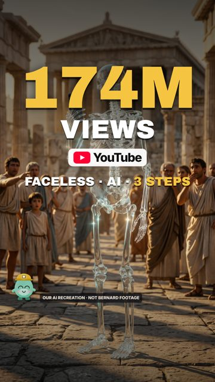

# 01 · Glass skeleton "What if…" history Shorts



**Inspired by:** [Bernard Films](https://www.youtube.com/@Bernard_Films) — 174.4M channel views across 29 Shorts (YouTube, checked Nov 2, 2026). View counts change; these are the numbers on the date shown.

> **Our rebuild, not the creator's confirmed workflow.** Bernard Films has not shared their tools. Everything below is how *we* rebuilt the format with public AI tools. No views or income are guaranteed; most videos get far fewer views than the example.

> **Gap:** our full automation script is not included in this public library, and its paid steps were never tested end-to-end. The tool stack and prices below are from our written guide; the final explainer reel's demo clips were made through OpenRouter.

## Costs at a glance
- **What our full demo production actually cost:** About **$0.42** logged OpenRouter spend for the final (v4) explainer reel's demo clips; earlier draft versions were not totalled here.
- **Estimated cost to make one example clip/Short yourself:** The guide's own estimate for a full 48–85 s Short: **≈ $4–5 budget, ≈ $10–12 full** (list prices, Nov 2026).
- Prices are list prices from early Nov 2026 and change often; check each tool's pricing page.

---


## 0. What you're copying (and what you're not)

**The facts.** These are from YouTube on Nov 2, 2026:
- Bernard Films (@Bernard_Films) joined Jan 23, 2026.
- It posted 29 Shorts between Feb 10 and Mar 26, 2026, which got **174.4M views** and **244K subscribers**.
- Its median Short has 2.7M views, and its top Short ("Could You Dig to the Earth's Core?") has 37.2M.
- It hasn't posted a Short since Mar 26.

**The format.**
- A second-person question title ("What if you had X in Y?").
- An escalation ladder ("Day 1… Day 2…", or depth or level rungs).
- An ironic twist at the end.
- A see-through glass skeleton as "you" in every shot.
- A counter top-centre, one word of caption at a time, and a new shot every 2–3 s.
- About 160–260 words, delivered fast, in 48–85 s.

**What's our rebuild.** Bernard hasn't named any tools. Everything below is *our* working rebuild using public tools, not his confirmed stack.

**Copy the machine, not the channel.**
- YouTube won't monetize content that's "mass-produced, generic, repetitive" ([policy](https://support.google.com/youtube/answer/1311392)).
- Bernard didn't invent the skeleton look either: Helix² was posting skeleton Shorts in Dec 2025.
- So pick **your own premise and your own character**, and keep each script genuinely researched.

---

## 1. One-time setup (about 1 hour)

| Account | Used for | Price (list, Nov 2026) |
|---|---|---|
| Anthropic API key ([console](https://platform.claude.com)) | Script and fact-check | Claude Sonnet 5.5: $2 / $10 per M tokens; web search $10 per 1,000 searches |
| Google AI Studio / Gemini API key | Images (Nano Banana 2.1) | About $0.034 per 1K image |
| fal.ai key | Animation (Kling 2.5 Turbo Pro image-to-video) | $0.07 per second of video |
| ElevenLabs API key + a voice ID | Voice with word timings | $0.08 per 1K characters (v2/v3/v4) |
| Google Cloud project with **YouTube Data API v3** + an OAuth client (an OAuth client file (keep it private)) | Auto-upload | Free; uploads have their own 100-a-day bucket |
| FFmpeg (with libass), Python 3.10+ | Assembly | Free |
| 3–5 music beds from the **YouTube Audio Library**, saved in `music/` | Background music | Free (check each track's licence) |

Install the Python packages: `pip install anthropic google-genai fal-client requests google-api-python-client google-auth-oauthlib`

---

## 2. Pick your premise (do this once, then reuse it)

Write 3–4 **sentence templates**. Bernard reused about 4. Examples of the shape:
- What if you had **[modern thing]** in **[era]**?
- **[Modern pro]** vs **[ancient place]**
- The smartest way to win **[rush / era]**
- Could you **[extreme challenge]**?

Then make it yours by changing the axis, not just the nouns. Some ideas:
- Jobs: "What if you were a [modern job] in [era]?"
- Places: "Could you survive a week in [extreme place]?"
- Money: "How would you get rich in [era] with [one skill]?"

**Prompt to generate 30 titles (Claude):**
```
Here are my 4 title templates: <paste>. Generate 30 Shorts titles: second person, a question, under
60 characters, each with an obvious "I'd want to see that" visual. Avoid real living people,
trademarked characters and gore. Return them as a numbered list, then mark the 10 with the strongest
escalation potential.
```

---

## 3. Build your character reference (once)

Make one clean reference image. You'll attach it to every scene so the character stays the same.

**Nano Banana 2.1 prompt** (model `gemini-nano-banana-2.1`, aspect ratio 9:16):
```
Full-body character reference sheet, front view, neutral pose, plain light-grey studio background.
A translucent glass human skeleton with softly visible internal organs, oversized expressive eye
sockets, photoreal cinematic 3D render, soft rim light. No text, no logo.
```

- Generate 4 versions, pick 1, and save it as `ref/skeleton.png`.
- Swap in your own character idea (a glass robot, a wax figure, and so on) to avoid looking like a clone.

---

## 4. Script prompt (Claude Sonnet 5.5)

```
You write YouTube Shorts in a second-person "escalation ladder" format.
Premise / title: {TITLE}
Rules:
- 170-210 words. Line 1 restates the title as a question, then the story starts.
- Second person, present tense, short sentences, dry deadpan humour.
- 9-13 rungs. Each rung: a counter label ("Day 1"... or depth/level/year), one concrete
  consequence, one small joke. Escalate the stakes every rung.
- Only defensible historical/scientific details; no invented quotes from real people.
- End on one ironic twist line that calls back to the premise.
- The viewer is always the same translucent glass skeleton.
Return ONLY JSON: {"title", "scenes":[{"label","vo","image_prompt","motion_prompt","hero"}]}
(hero = true for the ~8 most visual moments)
```

**Fact-check pass** (the same model with the web search tool on, max 5 searches):
```
Fact-check this Shorts script. Use web search for any specific historical or scientific claim.
List each claim, verdict (ok / wrong / unclear) and a one-line fix, then return the corrected JSON.
Keep the jokes; fix the facts.
```

---

## 5. Voice and word timings (ElevenLabs)

- Join all the `vo` lines and send them to `POST /v1/text-to-speech/{voice_id}/with-timestamps`.
- You get back `audio_base64` and per-character start and end times. Group the characters into words, and you have the timing for every word and every scene.
- **Voice settings:** pick a calm, slightly dry male or female narrator. You're aiming for about 190–210 words a minute, so if a voice reads slowly, shorten the script. Don't speed the audio up.

---

## 6. Scene images (Nano Banana 2.1)

For each scene, send `STYLE + scene.image_prompt` plus the reference image, with `response_format = {type: image, aspect_ratio: "9:16", image_size: "1K"}`.

STYLE line:
```
Photoreal cinematic 3D render, vertical 9:16, warm volumetric light, shallow depth of field.
Main character: the exact translucent glass skeleton with visible organs from the reference image,
same proportions and materials. No text, no watermark, no logos.
```
**Reroll rule:** if the character changes (extra limbs, a solid body, a different skull), regenerate it. Budget about 2× the number of images.

---

## 7. Motion (Kling 2.5 Turbo Pro image-to-video on fal.ai)

- Animate only the scenes marked `hero` (about 8). Use `duration: "5"`, or `"10"` if the scene runs over 5 s, and pass the scene's `motion_prompt`. One motion per clip, for example: "slow push-in as the skeleton swings the shovel, dust falls."
- Every other scene is a still with a slow 1.0→1.15× zoom (FFmpeg `zoompan`), which costs nothing.
- Trim each clip to its scene's length from the word timings. That gives you the 2–3 s cut rhythm automatically.

---

## 8. Captions, counter, music, assembly (FFmpeg)

- Build an `.ass` subtitle file with **one word per event**, centred and bold white with a black outline. Add the **scene label** ("Day 3", "1,000m") top-centre for the length of the scene, and your **@handle** small under the caption.
- Concatenate the clips, burn in the subtitles, and mix the voice with a music bed at about 12% volume.
- Export at 1080×1920, 30 fps, H.264, AAC.
- Also export a **contact sheet** (one frame every 3 s) so you can QA the whole video in 10 seconds.

---

## 9. QA before publishing (5 minutes; don't skip it)

- [ ] The character is the same in every frame (check the contact sheet).
- [ ] The fact-check notes have no "wrong" items left.
- [ ] No real living people, brands or copyrighted characters appear.
- [ ] Captions are in sync and nothing is cut off at the edges of a phone screen.
- [ ] The audio isn't clipping, and the music is licensed.

---

## 10. Upload and schedule (YouTube Data API)

- Call `videos.insert` with:
  - the title, plus `#shorts` in the description
  - `status.containsSyntheticMedia: true` (the AI-content disclosure)
  - `privacyStatus: "private"` with `publishAt` set to your posting time
- **Feedback loop:** after 7 days, pull each video's views (`videos.list`, part=statistics). Give Claude the top and bottom 5 and ask: "Which templates and rungs over-performed? Write 10 new titles in the winners' shape."

---

## 11. Cost per Short (our estimate, list prices, Nov 2026)

| Item | Budget | Full |
|---|---|---|
| Script + fact-check | ~$0.20 | ~$0.30 |
| ~25 images (with rerolls) | ~$0.85 | ~$1.70 |
| Animation | 8 × 5 s × $0.07 = $2.80 | 25 × 5 s × $0.07 = $8.75 |
| Voice (~1,300 chars) | ~$0.10 | ~$0.10 |
| Music | $0 | $0 |
| **Total** | **≈ $4–5** | **≈ $10–12** |

Not included: your time for QA, and failed or rerolled video generations.

---


### Honest limits
- We don't know Bernard's real tools, revenue or why he stopped posting.
- Results vary. Most Shorts get far fewer views than the ones above.
- AI video tools and their prices change often; check the linked pricing pages before you budget.

---

## Troubleshooting
- Character changes between shots → attach the same reference image every time and reroll the bad ones (budget ~2× images).
- Voice reads slowly → shorten the script; don't speed up the audio.
- Paid API steps in a full automated pipeline were **not** tested end-to-end by us; run your first video by hand.

## Rules
- Copy the format, not the videos. Never re-upload someone else's clips.
- Turn on the AI label (YouTube "altered or synthetic content", Instagram "AI info").

[← Back to all guides](../README.md)
