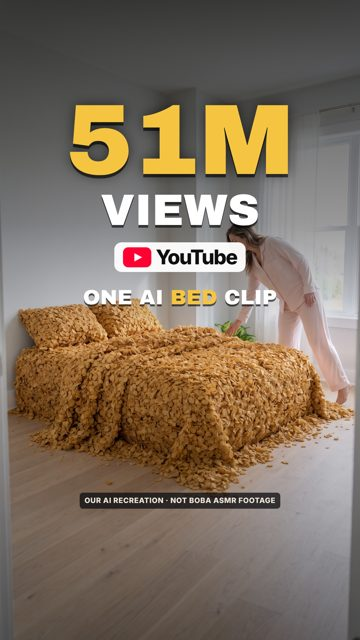

# 02 · "Which bed would you sleep in?" surreal beds ASMR



**Inspired by:** [Boba Asmr](https://www.youtube.com/@Boba-Asmr7) — 51M views on one 22 s clip (YouTube, Nov 3, 2026). View counts change; these are the numbers on the date shown.

> **Our rebuild, not the creator's confirmed workflow.** Boba Asmr has not shared their tools. Everything below is how *we* rebuilt the format with public AI tools. No views or income are guaranteed; most videos get far fewer views than the example.

## Costs at a glance
- **What our full demo production actually cost:** **$1.83** generation for our demo (room + 6 beds + three 6 s Veo clips), plus ~$0.01 voice-over.
- **Estimated cost to make one example clip/Short yourself:** **≈ $1.65–2.15 per 3-bed Short** at list prices; budget ~$3–4 with rerolls.
- Prices are list prices from early Nov 2026 and change often; check each tool's pricing page.

---

This is the exact workflow from the reel: 3 steps, every prompt, the settings and what it costs.

**What you're making:** a 20–25 second faceless YouTube Short / Reel. Three impossible beds (each made of one material) appear one after another. Someone lies down on each one and you hear the material (crunch, pop, squelch). No voice, no camera, no editing skills.

**Why it works:** the format that inspired this (Boba Asmr on YouTube) got 51 million views on one 22-second clip ("Which bed would you like to have?", views as of Nov 3, 2026). The bed is impossible, the sound is satisfying, and the title makes people pick one.

> Copy the format, not the videos. Use your own materials, your own room and your own sounds. YouTube won't pay for re-uploaded or copied content.

---

## What you need
- **Claude** (or any chat AI) for ideas
- **Nano Banana** (Google's image model, `gemini-nano-banana-2.1`) for the bed pictures
- **Veo 3.1 Lite** (Google's video model) with **sound turned on**, to animate each picture and create the ASMR sound
- Any editor to put 3 clips back to back (CapCut is fine)

I ran all three through **OpenRouter** (one account, pay per use). The app or website for each tool works just as well.

---

## Step 1 · IDEAS (Claude)

Copy this prompt exactly:

```
Give me 3 weird beds made entirely of one material for a 20-sec ASMR Short: one food, one object, one terrible. Add the sound each makes when someone lies down. One short line each.
```

What Claude gave me (real output, Claude Haiku):
1. Food bed (cornflakes): crunch... crsshhh... crunch
2. Object bed (bubble wrap): pop-pop-pop-pop-pop
3. Terrible bed (wet sponges): squish... glorp... squelch

Tips:
- Ask for 10 at a time and keep the ones you can *hear* in your head.
- The best mix is food + object + "terrible".
- Avoid materials big channels already used: bricks, circuit board, strawberry bingsu, glass, fruit jelly, nails.

---

## Step 2 · BEDS (Nano Banana)

**2a. Make one room reference first.** Every bed goes into this same room, which is what makes your videos look like a series.

```
An empty, bright, minimal bedroom: pale grey walls, a large window with sheer white curtains, light wood floor, a small potted plant, soft morning daylight. Open floor space in the center where a bed will go. Photoreal, wide eye-level shot, vertical 9:16.
```

**2b. Make each bed, attaching the room image as a reference.** Swap the material each time:

```
A bed made entirely of [MATERIAL], in the same bedroom as my reference. The mattress, pillows and blanket are all [MATERIAL]. A woman in pale pink pajamas stands beside it, about to lie down. Photoreal, soft daylight, vertical 9:16.
```

The exact ones I used:
- `A bed made entirely of cornflakes, in the same bedroom as my reference. The mattress, pillows and blanket are all cornflakes. A woman in pale pink pajamas stands beside it, about to lie down. Photoreal, soft daylight, vertical 9:16.`
- `A bed made entirely of bubble wrap, …` (same text, material swapped)
- `A bed made entirely of wet yellow sponges, … all soggy sponges. …`

Settings: aspect ratio **9:16**, resolution **2K**, **1 reference image** (the room).
Why the person is in the picture: video models animate a person who's already in frame far more reliably than one who has to walk in.

---

## Step 3 · ANIMATE + SOUND (Veo 3.1 Lite)

Use **image-to-video**, with the bed picture as the **first frame**. **Turn audio ON.** That's where the ASMR sound comes from: Veo generates it, no sound library needed.

```
The woman in pale pink pajamas pulls back the [MATERIAL] blanket and lies down on the [MATERIAL] bed, sinking in. Loud, crisp [SOUND] ASMR sound of [MATERIAL] with every movement. No music, no speech, no talking. Static camera, vertical 9:16.
```

The exact ones I used:
- Cornflakes: `The woman in pale pink pajamas pulls back the cornflake blanket and lies down on the cornflake bed, sinking in. Loud, crisp crunching ASMR sound of cornflakes with every movement. No music, no speech, no talking. Static camera, vertical 9:16.`
- Bubble wrap: `The woman in pale pink pajamas lies down on the bubble wrap bed and pulls the bubble wrap blanket over herself. Rapid, crisp bubble wrap popping ASMR sounds with every movement. No music, no speech, no talking. Static camera, vertical 9:16.`
- Sponges: `The woman in pale pink pajamas lies down on the wet sponge bed and sinks in; water squeezes out of the sponges. Squishy, squelching wet sponge ASMR sounds with every movement. No music, no speech, no talking. Static camera, vertical 9:16.`

Settings: **6 or 8 seconds**, **1080p**, **9:16**, **generate audio: on**, first frame = your bed image.
Tips:
- "No music, no speech" keeps the sound clean.
- The loudest sound is usually in seconds 1–3, so cut each clip to ~7 s around the action.
- If a clip comes out weird, reroll just that one.

---

## Put it together (5 minutes)
1. Put the 3 clips back to back (~7 s each, ~21 s total). Hard cuts, no transitions.
2. Keep the clips' own sound. No music, or a very quiet bed.
3. No voice-over and no text needed. Optional: small labels A / B / C.
4. **Title it as a question:** "Which bed would you sleep in? 🛏️ Cornflakes, Bubble Wrap, Wet Sponges #asmr"
5. Pin a comment: "A, B or C? 👇"
6. Post daily: new materials, same room, same sleeper.

---

## What it costs (OpenRouter list prices, Nov 3, 2026)

| Item | Price | Per Short |
|---|---|---|
| Claude Haiku (ideas) | $0.10 / $0.50 per million tokens | < $0.01 |
| Nano Banana 2.1 (room + 3 beds) | ~$0.055 per 2K image | ~$0.22 (the room image is reusable, so next time ~$0.17) |
| Veo 3.1 Lite, 1080p, with audio | $0.08 per second | 3 × 6 s = $1.44 · 3 × 8 s = $1.92 |
| **Total** | | **≈ $1.65–2.15 per Short** |

Cheaper: Veo 3.1 Lite at **720p with audio is $0.05/s**, so 3 × 8 s = $1.20 and a Short is ~$1.40 (a bit softer picture).
With a reroll or two, budget **~$3–4**.
My real spend for the demo in this reel (1 Claude idea call plus one retry, the room and 6 beds, three 6-second Veo clips with sound): **$1.83 in generation**, plus $0.01 for my voice-over.

---

## Rules so it doesn't get flagged
- Make your own materials and rooms. Don't re-upload anyone's clips.
- Turn on the platform's **AI-generated label** when you post (YouTube "altered or synthetic content", Instagram "AI info").
- Don't put real, recognisable people in the bed.


*(The 51M figure is Boba Asmr's public YouTube view count on Nov 3, 2026. The tools above are my rebuild of the format, not their confirmed workflow.)*

---

## Troubleshooting
- Person fails to appear/lie down → keep the person already in the still frame.
- Music or speech leaks into the sound → keep "No music, no speech, no talking" in the prompt.
- One weird clip → reroll only that clip.

## Rules
- Copy the format, not the videos. Never re-upload someone else's clips.
- Turn on the AI label (YouTube "altered or synthetic content", Instagram "AI info").

[← Back to all guides](../README.md)
