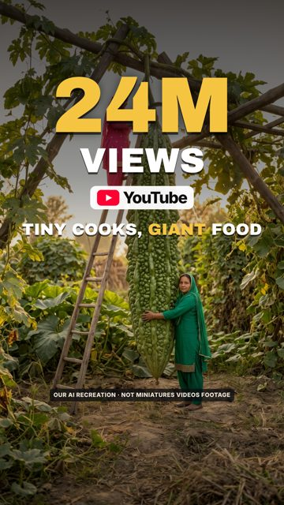

# 03 · Tiny cooks, giant food



**Inspired by:** [Miniatures videos](https://www.youtube.com/@Miniaturesvideos) — 24.4M views on one 50 s Short (YouTube, Nov 4, 2026). View counts change; these are the numbers on the date shown.

> **Our rebuild, not the creator's confirmed workflow.** Miniatures videos has not shared their tools. Everything below is how *we* rebuilt the format with public AI tools. No views or income are guaranteed; most videos get far fewer views than the example.

## Costs at a glance
- **What our full demo production actually cost:** **$2.37** total for our demo (9 images, two 6 s Veo openers incl. one reroll, three 5 s Kling clips, voice-over).
- **Estimated cost to make one example clip/Short yourself:** **≈ $7 per 15-shot Short** with Kling (up to ~$14 with rerolls), or ~$2 with Veo 720p no-audio.
- Prices are list prices from early Nov 2026 and change often; check each tool's pricing page.

---

This is the exact workflow from the reel: 3 steps, every prompt, the settings and what it costs.

**What you're making:** a 35–50 second faceless YouTube Short / Reel. A crew of tiny village cooks takes on one giant dish, from the farm to the plate: harvest it, haul it, wash it, chop it, cook it, serve it. 12–16 short shots, music, no voice, no camera.

**Why it works:** the format that inspired this (Miniatures videos on YouTube) got 24.4 million views on one 50-second Short ("Tiny ladies make a giant Chicken Stuffed Bitter gourd", views as of Nov 4, 2026). Scale contrast grabs you in frame 0, the dish is familiar comfort food, and "how will they cook THAT?" keeps people watching to the end.

> Copy the format, not the videos. Use your own dishes, your own cooks and your own music. YouTube won't pay for re-uploaded or copied content.

---

## What you need
- **Claude** (or any chat AI) for the shot-by-shot story
- **Nano Banana** (Google's image model, `gemini-nano-banana-2.1`) for the scenes
- **Kling 3.0** (or **Veo 3.1 Lite**) image-to-video to animate each scene
- Any editor (CapCut is fine) + a royalty-free music track (YouTube Audio Library)

I ran all of them through **OpenRouter** (one account, pay per use). Each tool's own app works just as well.

---

## Step 1 · SCRIPT (Claude)

```
Write an 8-shot story for a 40-sec Short: tiny village women cook one giant [DISH], from harvesting it on the farm to serving it. One action per shot, one line each.
```

What Claude gave me for a stuffed bitter gourd (real output, Claude Haiku):
1. Dawn light spills across a terraced farm as a woman in a faded blue sari kneels at the vine, her hands parting the leaves.
2. She twists a fat, warty bitter gourd free from the stem with a sharp snap.
3. Three women carry the gourd between them in a woven basket down a dirt path toward the village.
4. At the courtyard hearth, one woman slices the gourd lengthwise, revealing its pale green flesh.
5. Another scoops out the bitter seeds with a steel spoon, rinsing the hollow shell in a clay bowl.
6. Hands mix a spiced filling of onion, tamarind, and roasted peanuts, then pack it tightly into the gourd's hollow.
7. The stuffed gourd is lowered into a deep pot of simmering oil and tomato, the surface hissing as the women watch.
8. On a brass plate, the golden, glistening gourd is served to a circle of smiling elders, and the first bite is taken.

Notice Claude didn't keep "tiny" and "giant" in every line. That's fine: the image prompt in step 2 adds the scale every time.

Tips:
- Pick dishes your audience already loves (samosa, paratha, biryani, pancakes, tacos…). Familiar food plus an absurd scale wins.
- Ask for 12–16 shots when you make the real thing. Each shot = one action (slice, lift, pour, flip).
- Put the most impossible moment (lifting, flipping, hauling) in the first 3 seconds.

---

## Step 2 · SCENES (Nano Banana)

**2a. Make your crew reference first.** Every shot uses this image so the same cooks appear in every scene. That's what makes it look like a series.

```
Character reference: four tiny Punjabi village women, each only knee-high next to an ordinary farm cart, wearing bright salwar kameez with dupattas: one hot pink, one emerald green, one mustard yellow, one teal. Warm, natural, friendly faces. Standing in a row on a sunny dirt farm path, full body. Photoreal, warm golden daylight, vertical 9:16.
```
(Swap in your own crew: tiny grandmas, tiny chefs, tiny farmers. Keep the costume colours distinct so viewers can track them.)

**2b. Draw each shot with the reference attached:**

```
Shot [N]: [Claude's line]. The same tiny women from my reference, beside a giant [DISH] far bigger than them, rural village, golden light, photoreal, vertical 9:16.
```

The exact ones I used:
- **Opener (the shot from the reel):** `Wide low-angle shot in a sunlit farm field: one enormous bitter gourd, as long as a bus and as thick as a tree trunk, hangs from a giant vine. The tiny women in pink and green from my reference look like little dolls beside it: the woman in pink stands on the top of a tall wooden ladder and slices the thick stem with a big sickle, the woman in green stands on the ground hugging the bottom of the gourd, which towers three times her height. Ordinary-size crops around them look huge. Photoreal, golden hour, vertical 9:16.`
  (My first try just said "a giant bitter gourd three times their height" and the gourd came out only about as tall as the women. Spell the scale out with comparisons: "as long as a bus", "like little dolls".)
- **Shot 3:** `Shot 3: Three women carry the gourd between them in a woven basket down a dirt path toward the village. The same tiny women from my reference, beside a giant bitter gourd far bigger than them, rural Punjab village, golden light, photoreal, vertical 9:16.`
- **Shot 4:** `Shot 4: At the courtyard hearth, one woman slices the gourd lengthwise, revealing its pale green flesh. The same tiny women from my reference, …` (same ending)
- **Shot 7:** `Shot 7: The stuffed gourd is lowered into a deep pot of simmering oil and tomato, the surface hissing as the women watch. The same tiny women from my reference, …`
- **Shot 8:** `Shot 8: On a brass plate, the golden, glistening gourd is served to a circle of smiling elders, and the first bite is taken. The same tiny women from my reference, …`
- **New dishes, same cooks:** `The same tiny women from my reference roll out a giant aloo paratha as big as a trampoline on a clay courtyard floor, golden light, photoreal, vertical 9:16.` / `… squeeze a giant mango taller than them into a huge steel glass of mango lassi, village courtyard …`

Settings: **9:16**, **2K**, **1 reference image** (the crew).
Tips for scale: give them props that show size (ladders, ropes, carts, a giant wok, a rolling pin as long as a tree trunk).

---

## Step 3 · ANIMATE (Kling 3.0 or Veo 3.1 Lite)

Image-to-video, with each scene as the **first frame**:

```
The tiny women [ACTION FROM THE SHOT], gentle handheld camera, natural motion.
```

The exact ones I used:
- Opener (Veo 3.1 Lite, 6 s, 1080p): `The tiny woman in pink on the ladder saws back and forth at the thick vine stem with her sickle while the tiny woman in green hugs the single giant bitter gourd to steady it; the gourd sways gently but stays hanging on its vine. Only one gourd in the scene. Slow gentle push-in, natural motion, golden light. No text.`
  (On the first try the gourd fell and a second one appeared on the vine. "Only one gourd" plus "stays hanging" fixed it.)
- Shot 3 (Kling 3.0, 5 s): `The tiny women carry the giant bitter gourd in the woven basket down the dirt path toward the village, gentle handheld camera, natural motion.`
- Shot 4: `The tiny woman in pink slices the giant bitter gourd lengthwise with a big knife while the others watch, gentle handheld camera, natural motion.`
- Shot 7: `The stuffed giant bitter gourd is lowered into the huge pot of simmering oil and tomato, the surface bubbling and steaming as the tiny women watch, gentle handheld camera, natural motion.`

Settings: **5 s** (Kling) or **6 s** (Veo), **9:16**, audio **off** (music goes on in the edit).
Tips:
- Keep one action per clip. Two actions in one prompt usually turn into a mess.
- Trim every clip to its best **2–3 seconds**.
- If a clip warps, reroll just that one.

---

## Put it together (10 minutes)
1. Lay the clips in story order, farm → plate, **hard cuts every 2–3 s**.
2. Add one upbeat music track (royalty-free). No voiceover, no captions needed.
3. **Title formula:** "Tiny ladies make a giant [DISH] 🥒" + a few hashtags (#miniaturefood #aivideo).
4. End on the finished dish, big and steaming.
5. Post daily: new dish, same cooks.

---

## What it costs (OpenRouter list prices, Nov 4, 2026, estimates)

| Item | Price | Per Short (15 shots) |
|---|---|---|
| Claude Haiku (story) | $0.10 / $0.50 per million tokens | < $0.01 |
| Nano Banana 2.1 (crew + 15 scenes) | ~$0.055 per 2K image | ~$0.88 (the crew image is reusable) |
| Kling 3.0 Std, 5 s clips | $0.084 per second | 15 × 5 s = $6.30 |
| **Total** | | **≈ $7 per Short** |

Cheaper: Veo 3.1 Lite at **720p, no audio, is $0.03/s**, so 12 × 4 s clips = $1.44 and a Short is ~$2.
With rerolls, budget **up to ~$14**.
My real spend for the demo in this reel: **$2.36 in generation**. That covered 1 Claude story, 9 Nano Banana images (the crew, 2 tries at the opener, 4 story shots, 2 new dishes; $0.50), two 6-second Veo openers ($0.60, one reroll) and three 5-second Kling clips ($1.26). The voiceover for my reel was another $0.01.

---

## Rules so it doesn't get flagged
- Make your own dishes, cooks and music. Don't re-upload anyone's clips.
- Turn on the platform's **AI-generated label** when you post (YouTube "altered or synthetic content", Instagram "AI info").
- Show the culture you depict with respect: real dishes, real places, no caricatures.


*(The 24.4M figure is Miniatures videos' public YouTube view count on Nov 4, 2026. The tools above are my rebuild of the format, not their confirmed workflow.)*

---

## Troubleshooting
- Food not giant enough → spell out scale ("as long as a bus", "like little dolls"); our first try failed this way.
- Extra objects appear / food falls → say "Only one [food] in the scene" and "stays hanging"; this fixed our reroll.
- Messy motion → one action per clip, trim to the best 2–3 s.

## Rules
- Copy the format, not the videos. Never re-upload someone else's clips.
- Turn on the AI label (YouTube "altered or synthetic content", Instagram "AI info").

[← Back to all guides](../README.md)
