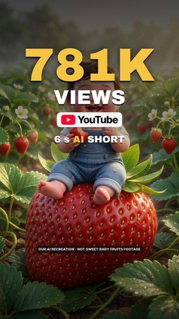

# 04 · Pixar-style baby on a giant fruit



**Inspired by:** [Sweet Baby Fruits](https://www.youtube.com/@SweetBabyFruits) — 781,501 views on a 6 s Short posted when the channel was 2 days old (YouTube, Nov 5, 2026). View counts change; these are the numbers on the date shown.

> **Our rebuild, not the creator's confirmed workflow.** Sweet Baby Fruits has not shared their tools. Everything below is how *we* rebuilt the format with public AI tools. No views or income are guaranteed; most videos get far fewer views than the example.

> ⚠️ **Kids-content caution:** this is a baby/kids-adjacent AI format. YouTube has been tightening on mass-produced and kids-adjacent AI content. Keep it wholesome, label it as AI, don't mark it "made for kids" without checking the rules, and expect extra review or limited monetization.

## Costs at a glance
- **What our full demo production actually cost:** **$0.95** total for our demo (4 stills, one 6 s Veo clip, one 5 s Kling clip, voice-over).
- **Estimated cost to make one example clip/Short yourself:** **~$0.35–0.50 per daily 6 s Short** (1 still + 1 Veo clip), estimate.
- Prices are list prices from early Nov 2026 and change often; check each tool's pricing page.

---

This is the exact workflow from the reel: 3 steps, every prompt, the settings and what it costs.

**What you're making:** a 6-second faceless YouTube Short. One Pixar-style AI baby sits on a giant fruit, takes a cute bite, done. New fruit every day, same baby.

**Why it works:** the format that inspired this (Sweet Baby Fruits on YouTube) got **781,501 views** on a 6-second strawberry Short posted when the channel was **2 days old** (views as of Nov 5, 2026). Instant cute payoff, zero speaking, one clear character.

> Copy the format, not the videos. Use your own baby design and your own fruits. YouTube won't pay for re-uploaded or copied content. Kids-adjacent AI content is under tighter review — keep it wholesome and label AI.

---

## What you need
- **Claude** (or any chat AI) for fruit + scene ideas
- **Nano Banana** (`google/gemini-nano-banana-2.1`) for the baby stills
- **Veo 3.1 Lite** or **Kling 3.0** image-to-video for the 6 s clip
- Any editor (CapCut is fine) + a short royalty-free music sting

I ran all of them through **OpenRouter**. Each tool's own app works just as well.

---

## Step 1 · IDEA (Claude)

```
Give me 10 baby-fruit Short ideas for a Pixar-style AI baby on a giant fruit. Format each as: Fruit | Setting | Action. One line each. Keep them cute and short.
```

What Claude gave me (real output, Claude Haiku 5.5):
1. Peach | Sunny orchard hilltop | Baby AI rolls down the fuzzy peach, giggling as it bounces off a branch
2. Watermelon | Summer picnic blanket | Baby AI surfs the striped rind like a tiny boat, splashing juice everywhere
3. Pineapple | Tropical beach at sunset | Baby AI climbs the spiky crown and waves to a passing seagull
4. Strawberry | Garden patch after rain | Baby AI hops from seed to seed, counting them with a happy beep
5. Mango | Jungle clearing | Baby AI slides down the golden curve and lands in a puddle of sticky sweetness
6. Lemon | Sunny kitchen windowsill | Baby AI tries to squeeze the lemon, then makes a funny sour face
7. Coconut | Palm-lined island | Baby AI bounces on the coconut like a ball while crabs scatter cheerfully
8. Cherry | Bright red cherry orchard | Baby AI swings from the stem like a vine, laughing as the tree sways
9. Apple | Autumn meadow | Baby AI rolls down the red apple, collecting falling leaves on its antenna
10. Blueberry | Misty morning forest | Baby AI tiptoes across the giant berry, sending tiny dewdrops sparkling in the light

Tips: pick one fruit per Short. Keep the action to a single bite / hop / slide so a 6 s clip can hold it.

---

## Step 2 · CHARACTER (Nano Banana)

**2a. Make your baby reference first** (one still you reuse forever):

```
Pixar-style chubby baby sitting on a giant ripe strawberry, strawberry garden with soft morning light, cute happy eating expression, soft cinematic 3D look, vertical 9:16, no text, no watermark
```

**2b. New fruit, same baby** — attach the reference every time:

```
Same Pixar-style chubby baby from the reference image, now sitting on a giant yellow banana, banana grove background, cute happy expression, soft cinematic 3D look, vertical 9:16, no text
```

Swap banana → kiwi / mango / peach / whatever Claude picked.

Settings: **9:16**, **2K**, **1 reference image**.

---

## Step 3 · ANIMATE (Veo 3.1 Lite or Kling 3.0)

Image-to-video, baby still as the **first frame**, **no audio**, **9:16**:

```
The Pixar-style baby happily takes a bite of the giant strawberry, gentle camera push-in, soft breeze moving strawberry leaves, cute and wholesome
```

- **Veo 3.1 Lite**, 6 s, 1080p → sharper (~$0.30). Best for the hero / first Short.
- **Kling 3.0 Std**, 5 s, ~716×1284 → softer (~$0.42). Fine for daily variants.

Trim to 6 s, add a short music sting, title like "Meet the Cutest Baby <Fruit> Ever!".

---

## Cost (what I actually spent on this rebuild, OpenRouter list prices Nov 5 2026)
| Piece | Cost |
|---|---|
| Claude ideas | ~$0.0002 |
| 4 Nano Banana stills (hero + banana + kiwi + mango) | ~$0.22 |
| Veo 3.1 Lite opener 6 s 1080p | $0.30 |
| Kling 3.0 Std banana clip 5 s | $0.42 |
| Sabrina VO (for the explainer reel, not needed for your Shorts) | ~$0.01 |
| **Total this rebuild** | **~$0.95** |
| **Per daily Short (still + 6 s Veo)** | **~$0.35–0.50 (est.)** |

---

## Rules
- Your own baby design, your own fruits, your own music
- Turn the AI label on
- Keep it wholesome; kids-adjacent AI gets extra scrutiny
- Never re-upload someone else's Shorts


---

## Troubleshooting
- Kling output was soft (~716×1284) in our test; Veo 1080p was sharper.
- Baby looks different each time → always attach the same reference still.
- Keep actions to one bite/hop so 6 s can hold it.

## Rules
- Copy the format, not the videos. Never re-upload someone else's clips.
- Turn on the AI label (YouTube "altered or synthetic content", Instagram "AI info").

[← Back to all guides](../README.md)
