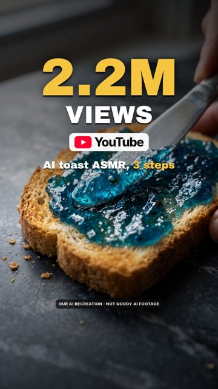

# 05 · AI toast ASMR



**Inspired by:** [Goody AI](https://www.youtube.com/shorts/3vBlSffRR0A) — 2,252,170 views on a 24 s Short (YouTube, Nov 5, 2026). View counts change; these are the numbers on the date shown.

> **Our rebuild, not the creator's confirmed workflow.** Goody AI has not shared their tools. Everything below is how *we* rebuilt the format with public AI tools. No views or income are guaranteed; most videos get far fewer views than the example.

## Costs at a glance
- **What our full demo production actually cost:** **$0.81** total for our demo (6 stills, one 6 s Veo clip with audio, voice-over).
- **Estimated cost to make one example clip/Short yourself:** **~$0.50 per toast Short** (1 still + 1 Veo-with-audio clip), estimate.
- Prices are list prices from early Nov 2026 and change often; check each tool's pricing page.

---

This is the exact workflow from the reel: 3 steps, every prompt, the settings and what it costs.

**What you're making:** a 24-second faceless YouTube Short. One butter knife spreading a weird glossy thing on toast, with crunch ASMR audio. New spread every day, same toast setup.

**Why it works:** the format that inspired this (Goody AI on YouTube) got **2,252,170 views** on a 24-second "blue raspberries on toast" Short (views as of Nov 5, 2026). Instant sensory payoff, zero speaking, one clear loop.

> Copy the format, not the videos. Use your own spreads. YouTube won't pay for re-uploaded or copied content. Label AI.

---

## What you need
- **Claude** (or any chat AI) for weird spread ideas
- **Nano Banana** (`google/gemini-nano-banana-2.1`) for the glossy still
- **Veo 3.1 Lite** image-to-video **with audio** for the 6 s crunch clip
- Any editor (CapCut is fine) + optional music bed under the crunch

I ran all of them through **OpenRouter**. Each tool's own app works just as well.

---

## Step 1 · IDEA (Claude)

```
List 10 weird fantastical things to spread on toast for a 24-second AI ASMR Short. Think glossy surreal food (crystal jam, lava honey, galaxy jelly, molten gemstones) — not ordinary pantry spreads. No brands. One short line each, numbered.
```

What Claude gave me (real output, Claude Haiku 5.5):
1. Crystal jam that chimes softly as it sets into faceted geodes on the toast
2. Lava honey that glows orange and bubbles slowly, cooling to amber glass
3. Galaxy jelly swirling with tiny pinpricks of starlight and drifting nebula clouds
4. Molten opal spread that shifts rainbow colors with every slow, glossy drip
5. Moonstone butter that gleams pale silver and hums faintly as it melts into the bread
6. Aurora marmalade rippling in green and violet ribbons across the crust
7. Liquid amethyst preserve that pools in deep purple veins and catches the light
8. Volcanic cherry curd that sizzles and steams as it spreads over warm toast
9. Mercury-silver fig paste that slides in heavy, reflective ribbons and never quite stops moving
10. Sunstone nectar that drips in golden molten beads and leaves a shimmering, glowing trail

Tips: one spread per Short. Keep the action to a single slow knife drag so a 6–24 s clip can hold it.

---

## Step 2 · LOOK (Nano Banana)

```
Macro photo, butter knife spreading glossy translucent blue raspberries on golden toast, crystal-like gelatinous texture, dark marble counter, soft side light, vertical 9:16, no text, no watermark, photoreal ASMR food close-up
```

Swap "blue raspberries" for whatever Claude picked (lava honey, galaxy jelly, crystal kiwi…).

Settings: **9:16**, **2K**. No reference needed for this format (each spread can be its own still).

---

## Step 3 · ANIMATE (Veo 3.1 Lite + audio)

Image-to-video, still as the **first frame**, **generate audio ON**, **9:16**, **6 s**, **1080p**:

```
Knife slowly spreads glossy blue raspberry crystals across golden toast, crisp crunch ASMR sound of knife scraping toast crust, static macro camera, photoreal food ASMR
```

The crunch is the whole point — turn audio on. Trim/loop to 24 s if you want the longer Short length, or leave it as a 6 s loop. Optional soft music bed under the crunch at low volume.

---

## Cost (what I actually spent on this rebuild, OpenRouter list prices Nov 6 2026)
- Claude idea list: < $0.01
- Nano Banana stills (hero + 5 variants): ~$0.32
- Veo 3.1 Lite 6 s 1080p **with audio**: $0.48
- Sabrina TTS for the breakdown reel: ~$0.01
- **Per toast Short (1 still + 1 Veo with audio): ~$0.50 (est.)**

---

## Caption / posting tips
- Hook with the view count in the first line
- Comment-keyword CTA: "Comment GUIDE"
- 5 hashtags max
- Label AI content on Instagram


---

## Troubleshooting
- No crunch sound → make sure generate-audio is ON (costs more: $0.48 vs $0.30 muted for 6 s in our test).
- Spreads too ordinary → ask Claude for "glossy surreal" spreads, no pantry items, no brands.
- Our demo used one 6 s clip; looping to 24 s is untested by us.

## Rules
- Copy the format, not the videos. Never re-upload someone else's clips.
- Turn on the AI label (YouTube "altered or synthetic content", Instagram "AI info").

[← Back to all guides](../README.md)
