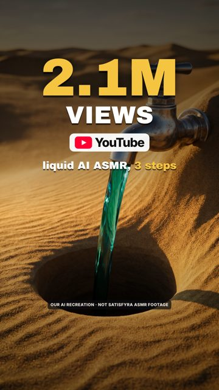

# 06 · Desert tap liquid ASMR



**Inspired by:** [Satisfyra ASMR](https://www.youtube.com/watch?v=6I2c5ZQZyGM) — 2,082,769 views on "Liquid Hole Universe (Part 26)", a landscape video, not a Short (YouTube, Nov 6, 2026). View counts change; these are the numbers on the date shown.

> **Our rebuild, not the creator's confirmed workflow.** Satisfyra ASMR has not shared their tools. Everything below is how *we* rebuilt the format with public AI tools. No views or income are guaranteed; most videos get far fewer views than the example.

> **Gap:** our notes for this format had no separate assembly/caption tips, so none are added here.

## Costs at a glance
- **What our full demo production actually cost:** **~$0.81** total for our demo (6 stills, one 6 s Veo clip with audio, voice-over).
- **Estimated cost to make one example clip/Short yourself:** **~$0.50 per Short** (1 still ~$0.05 + Veo 3.1 Lite 6 s with audio ~$0.48), estimate.
- Prices are list prices from early Nov 2026 and change often; check each tool's pricing page.

---

This is the exact workflow from the reel: 3 steps, every prompt, the settings and what it costs.

**What you're making:** a faceless YouTube Short (or vertical reel). One chrome tap pouring surreal liquid into a hole in a landscape, with soft pour ASMR audio. New landscape every day, same tap motif.

**Why it works:** the format that inspired this (Satisfyra ASMR on YouTube) got **2,082,769 views** on "Liquid Hole Universe (Part 26) AI ASMR" — a landscape video, not a Short (views as of Nov 6, 2026). Instant sensory payoff, zero speaking, one clear loop.

> Copy the format, not the videos. Use your own landscapes. YouTube won't pay for re-uploaded or copied content. Label AI.

---

## What you need
- **Claude** (or any chat AI) for surreal liquid-hole ideas
- **Nano Banana** (`google/gemini-nano-banana-2.1`) for the landscape still
- **Veo 3.1 Lite** image-to-video **with audio** for the 6 s pour clip
- Any editor (CapCut is fine) + optional music bed under the pour

I ran all of them through **OpenRouter**. Each tool's own app works just as well.

---

## Step 1 · IDEA (Claude)

```
List 10 surreal liquid-hole Short ideas: landscape + liquid + sound. No people, no brands. One short line each, numbered.
```

What Claude gave me (real output, Claude Haiku 5.5):
1. A desert sinkhole filling slowly with mercury, each drop ringing like a distant bell.
2. A canyon river that runs upward into a hole in the sky, humming a low chord as it drains.
3. A field of tar pits bubbling in rhythm, each pop tuned to a different note.
4. A glacier cracking open to reveal a pool of molten gold that whispers as it cools.
5. A salt flat where a hole fills with rain that sings back the wind's exact tone.
6. An ocean whirlpool spinning silently until its center opens and thunders like a cathedral organ.
7. A moss-covered crater where ink-black water rises and falls with the sound of breathing.
8. A cliffside cave where honey-thick liquid drips into a hollow that echoes like a struck gong.
9. A volcanic pit of glowing lava that crackles and hisses in perfect shortwave-radio static.
10. A lake that drains through a hole in the earth, its water roaring like a train passing through the hills.

Pick one landscape + liquid + sound. Keep people and brands out.

---

## Step 2 · LOOK (Nano Banana)

Settings: **9:16**, **2K**, no text/watermark.

```
Macro cinematic still, chrome faucet emerging from endless golden desert dunes, pouring glossy translucent teal liquid into a perfect circular void carved in sand, golden hour side light, vertical 9:16, no text, no watermark, photoreal surreal ASMR landscape, no people
```

Swap the landscape (ice cavern, lava crater, moss forest, glass canyon, night dunes…) but keep the chrome tap + perfect circular void motif so the series feels consistent.

---

## Step 3 · ANIMATE (Veo 3.1 Lite + audio)

Settings: image-to-video, **6 s**, **1080p**, **generate_audio = true**, still as first frame.

```
Slow continuous pour from chrome desert faucet, glossy teal liquid fills the perfect sand void with soft ASMR glug and trickle, static camera, photoreal surreal landscape, no people
```

Cost at list prices (est.): still ~$0.05 + Veo Lite 6 s with audio ~$0.48 ≈ **~$0.50 a Short**.

---

Copy the format, not the videos. New landscape, same tap, a fresh Short every day.

---

## Troubleshooting
- No pour sound → generate-audio must be ON.
- Series looks inconsistent → keep the chrome tap + perfect circular hole in every landscape.
- The original reference is a long landscape video; we only tested a 6 s vertical clip.

## Rules
- Copy the format, not the videos. Never re-upload someone else's clips.
- Turn on the AI label (YouTube "altered or synthetic content", Instagram "AI info").

[← Back to all guides](../README.md)
