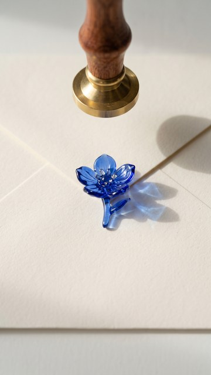

# 07 · Glass flower seals



**Inspired by:** [Fantasy ASMR Lab](https://www.youtube.com/watch?v=C5T-N9Egjtk) — 181,934 views on an AI ASMR glass birth-flower / birthstone sealing-stamp compilation (YouTube, Nov 7, 2026). View counts change; these are the numbers on the date shown. The source is a longer compilation, not a single six-second Short.

> **Our rebuild, not the creator's confirmed workflow.** Fantasy ASMR Lab has not shared their tools. Everything below is how *we* rebuilt one original glass-seal scene with public AI tools. No views or income are guaranteed; most videos get far fewer views than the example.

## Costs at a glance
- **What our full demo production actually cost:** **$0.65** total for our demo (3 stills, one 6 s Veo clip with audio, Claude + voice-over).
- **Estimated cost to make one example clip/Short yourself:** **~$0.53 per Short** (1 still ~$0.05 + Veo 3.1 Lite 6 s with audio ~$0.48), estimate.
- Prices are list prices from early Nov 2026 and change often; check each tool's pricing page.

---

This is the exact workflow from the reel: 3 steps, every prompt, the settings and what it costs.

**What you're making:** a faceless YouTube Short (or vertical reel). One glass flower on a plain envelope, pressed once into a circular translucent seal, with a crisp native glass crackle. New flower + color every day, same framing.

**Why it works:** the format that inspired this (Fantasy ASMR Lab on YouTube) got **181,934 views** on a glass sealing-stamp AI ASMR compilation (views as of Nov 7, 2026). Instant sensory payoff, zero speaking, one clear press.

> Copy the format, not the videos. Invent your own flowers and colors. YouTube won't pay for re-uploaded or copied content. Label AI.

---

## What you need
- **Claude** (or any chat AI) for flower + color + press ideas
- **Nano Banana** (`google/gemini-nano-banana-2.1`) for the top-down still
- **Veo 3.1 Lite** image-to-video **with audio** for the 6 s press clip
- Any editor (CapCut is fine) + optional music bed under the crackle

I ran all of them through **OpenRouter**. Each tool's own app works just as well.

---

## Step 1 · PLAN (Claude)

```
Give me 6 original glass-seal ideas. Each row: flower, two-color palette, one press action. No brands, characters or birth-month claims.
```

What Claude gave me (real output, Claude Haiku 5.5):
1. **Cobalt Wildflower**: A five-petaled bloom with a deep cobalt body and a pale center, pressed slowly so the glass pools into the petal curves and settles into a soft, uneven gloss.
2. **Amber Poppy**: A single cupped poppy in warm amber, its paper-thin petals pressed with one slow, steady hand so the color deepens toward the edges like sunlight through honey.
3. **Sage Lavender Sprig**: A slender lavender stem in muted sage green, flattened in one unhurried press that spreads the glass into delicate, tapering buds.
4. **Blush Cherry Blossom**: Five open petals in pale blush pink, pressed slowly so each petal holds a faint translucent ripple, with a tiny darker dot at the heart.
5. **Violet Iris**: A bold three-petaled iris in layered violet, its ruffled edges captured by a single slow press that leaves a glassy, sculpted ridge along each petal.
6. **Teal Daisy Cluster**: A cluster of small daisies in clear teal glass, pressed once and slowly so the rounded petals fuse into a soft, bubbled surface that catches light from every angle.

Pick one flower + color + press. Keep brands and birth-month claims out. Start with a single transformation, not a montage.

---

## Step 2 · FRAME (Nano Banana)

Settings: **9:16**, **2K**, no text/watermark. Reference the hero still for color variants.

```
Top-down macro photograph. A single original COBALT BLUE GLASS WILDFLOWER on a plain ivory envelope. Brass circular seal stamp poised above the glass flower, stamp suspended near upper edge. One object centered in middle third with room above for title and below for captions. Soft side light. Physically realistic crystal petals, no text, no logo, no people, vertical 9:16.
```

Swap the flower and color (amber poppy, sage lavender, blush cherry blossom…) but keep the plain envelope + brass stamp motif so the series feels consistent. Reject stills with broken petals, logos, or cluttered backgrounds.

---

## Step 3 · ANIMATE (Veo 3.1 Lite + audio)

Settings: image-to-video, still as the **first frame**, **generate_audio = true**, **9:16**, **6 s**, **1080p**.

```
Locked top-down macro camera. One slow downward brass stamp press on the cobalt glass flower. Flatten the flower into a circular translucent floral seal, then gently lift stamp. Single smooth action, no cuts, no camera movement. Crisp delicate glass crackle precisely at contact. No voice, no music. Preserve envelope geometry. Six seconds.
```

Reject broken stamp geometry, malformed petals, or discontinuous motion. The crackle is the payoff — keep audio on. Optional soft music bed under the crackle at low volume.

---

## Cost (what I actually spent on this rebuild, OpenRouter list prices Nov 7 2026)
- Claude idea list: < $0.01
- Nano Banana stills (hero + variants): ~$0.16
- Veo 3.1 Lite 6 s 1080p **with audio**: $0.48
- Sabrina TTS for the breakdown reel: ~$0.01
- **Demo total: $0.65**
- **Per Short (1 still + 1 Veo with audio): ~$0.53 (est.)**
- Each extra 6 s video attempt adds ~$0.48

---

## Caption / posting tips
- Hook with the view count in the first line
- Comment-keyword CTA: "Comment GUIDE"
- 5 hashtags max
- Label AI content on Instagram

---

## Troubleshooting
- **Stamp looks broken / flower shatters wrong:** reject and regenerate; don't fake a good take.
- **No crackle / silent clip:** confirm `generate_audio = true` and that you're not stripping audio on export.
- **Busy background / text in frame:** tighten the still prompt to plain envelope, no logos, soft side light only.
