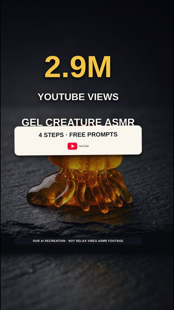

# 08 · Paint-tube sea creatures ASMR



**Inspired by:** [Relax Vibes ASMR](https://www.youtube.com/watch?v=meX41xw74YQ) (@Relax_Vibes_ASMR) — 2,916,698 views on "[ASMR] Magic Tubes Create Living Creatures" (YouTube, Nov 7, 2026). View counts change; these are the numbers on the date shown. The source is a **544-second** compilation, not a single six-second Short.

> **Our rebuild, not the creator's confirmed workflow.** Relax Vibes ASMR has not shared their tools. Everything below is how *we* rebuilt one original paint-tube sea-creature scene with public AI tools. No views or income are guaranteed; most videos get far fewer views than the example.

## Costs at a glance
- **What our full demo production actually cost:** **$0.65** total for our demo (3 stills, one 6 s Veo clip with audio, Claude + voice-over).
- **Estimated cost to make one example clip/Short yourself:** **~$0.53 per Short** (1 still ~$0.05 + Veo 3.1 Lite 6 s with audio ~$0.48), estimate.
- Prices are list prices from early Nov 2026 and change often; check each tool's pricing page.

---

This is the exact workflow from the reel: **4 steps**, every prompt, the settings and what it costs.

**What you're making:** a faceless YouTube Short (or vertical reel). One blank paint tube on a dark slate, slowly squeezed so translucent gel becomes a sea creature, with a soft native squish. New creature + color every day, same framing.

**Why it works:** the format that inspired this (Relax Vibes ASMR on YouTube) got **2,916,698 views** on a magic-paint-tube creature compilation (views as of Nov 7, 2026). Instant sensory payoff, zero speaking, one clear squeeze.

> Copy the format, not the videos. Invent your own creatures and colors. YouTube won't pay for re-uploaded or copied content. Label AI.

---

## What you need
- **Claude** (or any chat AI) for creature + gel color + squeeze ideas
- **Nano Banana** (`google/gemini-nano-banana-2.1`) for the macro tube still
- **Veo 3.1 Lite** image-to-video **with audio** for the 6 s squeeze clip
- Any editor (CapCut is fine) for the FINISH trim/sync step + optional music bed under the squish

I ran all of them through **OpenRouter**. Each tool's own app works just as well.

---

## Step 1 · PLAN (Claude)

```
Give 6 original gel sea-creature reveals: creature, translucent gel color, one slow squeeze. Start with amber jellyfish. No faces, brands or baby animals.
```

What Claude gave me (real output, Claude Haiku 5.5):
1. **Amber Jellyfish**: Translucent honey-amber gel with tiny suspended bubbles. One slow squeeze makes the bell pulse outward, then drift back into a glowing, rounded dome.
2. **Violet Sea Anemone**: Clear violet gel with a deeper purple core. One slow squeeze unfurls a crown of tentacles from the center, each one curling outward like a blooming flower.
3. **Aqua Sea Turtle Shell**: Transparent aquamarine gel with swirled darker teal lines. One slow squeeze reveals a sleek, domed shell pattern that ripples across the surface as the gel settles.
4. **Rose Quartz Starfish**: Pale pink translucent gel with a glittering inner shimmer. One slow squeeze pushes five arms outward from a central disc, each arm stretching to a graceful point.
5. **Teal Octopus**: Clear teal gel with dark ink-blue swirls running through it. One slow squeeze spreads eight curling arms from a rounded head, the tips coiling gently as the gel relaxes.
6. **Clear Sea Dragon**: Crystal-clear gel with a faint green-gold tint. One slow squeeze stretches a slender, leaf-fringed body into an elegant S-curve, the delicate fins fluttering open.

Pick one creature + color + squeeze. Keep faces, brands and baby animals out. Start with a single transformation, not a montage.

---

## Step 2 · FRAME (Nano Banana)

Settings: **9:16**, **2K**, no text/watermark. Reference the hero still for color variants.

```
Macro side view, ONE unbranded silver metal paint tube on charcoal slate. No printed labels or text. Amber translucent gel just starting at single nozzle. No creatures yet. Moody rim light, clean minimalist composition. Tube lies in middle half of vertical image, empty upper area for title. No hands, no face, vertical 9:16.
```

Swap the gel color (violet, aquamarine, rose, teal…) but keep the **one blank tube + charcoal slate** motif so the series feels consistent. Reject stills with labels, logos, hands, faces, or cluttered backgrounds.

---

## Step 3 · ANIMATE (Veo 3.1 Lite + audio)

Settings: image-to-video, still as the **first frame**, **generate_audio = true**, **9:16**, **6 s**, **1080p**.

```
Locked macro camera. Unseen off-frame pressure slowly squeezes amber translucent gel out of the blank tube nozzle. Gel forms a tiny lifelike translucent amber jellyfish on slate, umbrella bell and delicate tentacles. One continuous slow squeeze. Soft wet squish synchronized to extrusion. No music, no voice, no cuts. Six seconds.
```

Reject broken tube geometry, malformed limbs/tentacles, or discontinuous nozzle motion. The squish is the payoff — keep audio on. Optional soft music bed under the squish at low volume.

---

## Step 4 · FINISH (local edit)

No extra paid model. Open the 6 s Veo clip in any editor and quality-check the usable moment:

1. **Trim the empty lead-in.** Keep from first visible extrusion to just before geometry fails. Our demo used **0.40 s → 5.60 s** of the 6 s clip.
2. **Inspect the native waveform.** Align the soft squish transient with the gel emerging from the nozzle. If video and audio are already locked in sync, **leave the offset at zero** — do not invent a re-sync just to "look edited."
3. **Edge fades.** Apply short fades on the sound at the cut points (**about 40–80 ms**; we used **60 ms**).
4. **Keep natural speed.** Do not time-stretch. Do not promise a seamless loop — end cleanly before the motion breaks.

This step is quality control on a real generation, not a guarantee of a perfect take.

---

## Cost (what I actually spent on this rebuild, OpenRouter list prices Nov 7 2026)
- Claude idea list: < $0.01
- Nano Banana stills (hero + variants): ~$0.16
- Veo 3.1 Lite 6 s 1080p **with audio**: $0.48
- Sabrina TTS for the breakdown reel: ~$0.01
- **Demo total: $0.65**
- **Per Short (1 still + 1 Veo with audio): ~$0.53 (est.)**
- Each extra 6 s video attempt adds ~$0.48

---

## Caption / posting tips
- Hook with the view count in the first line
- Comment-keyword CTA: "Comment GUIDE"
- 5 hashtags max
- Label AI content on Instagram

---

## Troubleshooting
- **Second tube appears despite a single-tube prompt:** Veo sometimes invents an extra tube. Reject and regenerate, or crop/trim to the usable single-tube moment — don't pretend the prompt always wins.
- **Broken nozzle / malformed tentacles / discontinuous squeeze:** reject and regenerate; don't fake a good take. Tentacle and flow geometry can look synthetic even on a usable clip.
- **No squish / silent clip:** confirm `generate_audio = true` and that you're not stripping audio on export.
- **Empty lead-in or late failure:** trim to first visible extrusion and cut before geometry fails (see Step 4).
- **Busy background / labels in frame:** tighten the still prompt to one blank tube, charcoal slate, no text, no hands.

## Rules
- Copy the format, not the videos. Never re-upload someone else's clips.
- Turn on the AI label (YouTube "altered or synthetic content", Instagram "AI info").

[← Back to all guides](../README.md)
