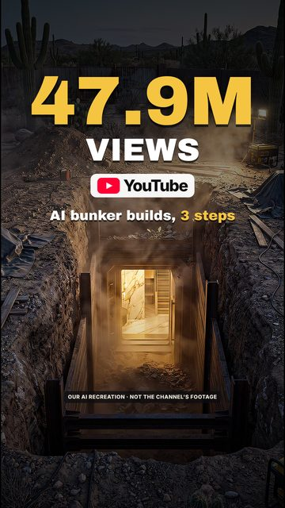

# 09 · Luxury desert bunker AI build



**Inspired by:** [Not Your Basic Builds](https://www.youtube.com/watch?v=wlLS6XfQ5lU) (@Not_Your_Basic_Builds) — **47,884,973** views on "I Built a Luxury Underground Bunker in the Desert" (42 s; YouTube, Nov 9, 2026). Channel: **530K** subscribers, **514,394,071** total views (about page, same date). View counts change; these are the numbers on the date shown. Keywords on that video include "AI Video" / "Generative AI".

> **Our rebuild, not the creator's confirmed workflow.** Not Your Basic Builds has not shared their tools. Everything below is how *we* rebuilt one original desert dig → luxury bunker reveal with public AI tools. No views or income are guaranteed; most videos get far fewer views than the example. Views are not income.

## Costs at a glance
- **What our full demo production actually cost:** **$0.81** total for our demo (6 stills, one 6 s Veo clip with audio, Claude + voice-over).
- **Estimated cost to make one example clip/Short yourself:** **~$0.53 per Short** (1 still ~$0.05 + Veo 3.1 Lite 6 s with audio ~$0.48), estimate.
- Prices are list prices from Nov 2026 and change often; check each tool's pricing page.

---

This is the exact workflow from the reel: **3 steps**, every prompt, the settings and what it costs.

**What you're making:** a faceless YouTube Short (or vertical reel). One locked-wide desert dig that excavates into a glowing luxury underground bunker entrance, with soft dig/rumble audio. New shelter location every day, same dig → reveal framing.

**Why it works:** the format that inspired this (Not Your Basic Builds on YouTube) got **47,884,973 views** on a desert luxury-bunker build Short (views as of Nov 9, 2026). Impossible "secret build" curiosity, zero speaking, one clear payoff.

> Copy the format, not the videos. Invent your own locations and interiors. YouTube won't pay for re-uploaded or copied content. Label AI.

---

## What you need
- **Claude** (or any chat AI) for location + dig + interior ideas
- **Nano Banana** (`google/gemini-nano-banana-2.1`) for the desert dig still (+ location variants)
- **Veo 3.1 Lite** image-to-video **with audio** for the 6 s excavate clip
- Any editor (CapCut is fine) + optional music bed under the dig rumble

I ran all of them through **OpenRouter**. Each tool's own app works just as well.

---

## Step 1 · IDEA (Claude)

```
List 8 original faceless Short ideas for a luxury underground bunker reveal. Each: one location + one dig action + one interior payoff. No faces, brands, celebrities, or copyrighted places. Number them 1-8. Keep each line under 12 words.
```

What Claude gave me (real output, Claude Haiku 4.5):

1. Desert canyon → excavating through rust-colored stone → crystal geode spa chamber
2. Alpine mountain → drilling past glacial ice layers → subterranean thermal pool oasis
3. Coastal cliff → blasting through stratified rock face → oceanview observation bubble room
4. Volcanic region → tunneling through ancient lava tubes → obsidian wine vault gallery
5. Forest hillside → clearing dense root systems → sunlit atrium with living walls
6. Limestone plateau → carving through white stone passages → underground cinema with stalactites
7. Tundra terrain → melting permafrost with heated equipment → geothermal relaxation chamber below
8. Desert basin → removing layers of sediment → subterranean infinity pool with skylight

Pick one location + dig + interior. We rebuilt a **desert patio / cactus dig → glowing luxury bunker entrance** (our original scene, not a frame copy of theirs). Keep faces, brands and real private places out.

---

## Step 2 · LOOK (Nano Banana)

Settings: **9:16**, **2K**, no text/watermark.

**Hero still (desert dig — used as Veo first frame):**

```
Cinematic vertical 9:16 still, desert backyard with cacti, wide locked camera, mid-excavation trench opening into a glowing luxury underground bunker entrance with warm golden interior light, marble hint, dust in air, photoreal, no people, no text, no logos.
```

**Location variants (same dig → reveal motif, swap the setting):**

```
Cinematic vertical 9:16 still, underside of a suburban swimming pool, glass ceiling of water above, mid-excavation revealing a glowing luxury underground lounge entrance with warm golden light, photoreal, no people, no text, no logos.
```

```
Cinematic vertical 9:16 still, waterfall cliff face, locked wide camera, trench cut into wet rock opening into a glowing luxury bunker entrance with warm golden interior, mist and spray, photoreal, no people, no text, no logos.
```

```
Cinematic vertical 9:16 still, forest hillside, roots and soil mid-excavation revealing a sunlit luxury underground atrium entrance with warm light, photoreal, no people, no text, no logos.
```

```
Cinematic vertical 9:16 still, coastal cliff edge, rock excavation opening into an ocean-view luxury bunker observation room with golden interior glow, photoreal, no people, no text, no logos.
```

```
Cinematic vertical 9:16 still, dark volcanic rock landscape, lava-tube tunnel opening into an obsidian luxury wine vault bunker with warm amber light, photoreal, no people, no text, no logos.
```

Keep the **locked-wide dig opening into a glowing interior** so the series feels consistent. Reject stills with people, logos, unreadable text, or a cluttered frame.

---

## Step 3 · ANIMATE (Veo 3.1 Lite + audio)

Settings: image-to-video, hero still as the **first frame**, **generate_audio = true**, **9:16**, **6 s**, **1080p**.

```
Locked wide camera, continuous 6 seconds: sand and dirt excavate from a desert patio trench with cacti, revealing a glowing luxury bunker entrance with warm golden interior light; soft dig and rumble ASMR, no music, no voice, no people, no cuts.
```

Reject broken trench geometry, morphing interiors, or discontinuous dig motion. The dig rumble is the payoff — keep audio on. Optional soft music bed under the rumble at low volume.

---

## Cost (what I actually spent on this rebuild, OpenRouter list prices Nov 9 2026)
- Claude idea list (Haiku 4.5): **$0.001**
- Nano Banana stills ×6 (hero + 5 variants): **$0.320**
- Veo 3.1 Lite 6 s 1080p **with audio**: **$0.48**
- Sabrina TTS for the breakdown reel: **~$0.008**
- **Demo total: $0.81**
- **Per Short (1 still + 1 Veo with audio): ~$0.53 (est.)**
- Each extra 6 s video attempt adds ~$0.48

---

## Caption / posting tips
- Hook with the view count in the first line
- Comment-keyword CTA: "Comment GUIDE"
- 5 hashtags max
- Label AI content on Instagram

---

## Troubleshooting
- **Trench / bunker door morphs or collapses wrong:** reject and regenerate; don't fake a good take. Dig geometry often fails mid-clip.
- **No rumble / silent clip:** confirm `generate_audio = true` and that you're not stripping audio on export.
- **People or logos in the still:** tighten the prompt (`no people, no text, no logos`) and regenerate.
- **Subject off-center in 9:16:** crop/reframe so the dig opening sits near the vertical center before animating.
- **Interior too dark to read as "luxury":** ask for warm golden interior light / marble hint in the still prompt.

## Rules
- Copy the format, not the videos. Never re-upload someone else's clips.
- Turn on the AI label (YouTube "altered or synthetic content", Instagram "AI info").
- Our footage is tagged as an AI recreation — do the same on yours.

[← Back to all guides](../README.md)
