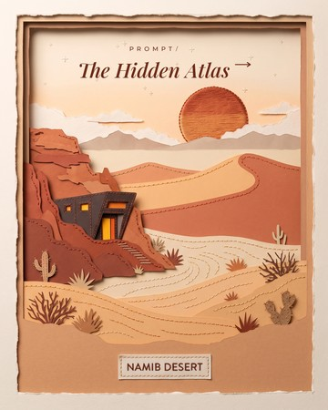

# 10 · The Hidden Atlas



A 12-slide Instagram carousel of **handmade paper-cut diorama posters**: secret luxury bunkers and hideouts around the world, all in one craft style, each with a sewn location label. Built for [@faceless.recipes](https://www.instagram.com/faceless.recipes/).

> **A stills prompt pack, not a reel workflow.** These are AI-generated paper-cut artworks of fictional hideouts, not photographs of real places, and not anyone's confirmed process. No views or income are guaranteed.

## Costs at a glance
- **Estimated cost to make the 10 location stills yourself:** **~$0.56** (10 Nano Banana 2K stills at about $0.056 each, Nov 2026 list prices through OpenRouter). Cover and CTA typography are added in any image editor, at no model cost.
- Prices change often; check the tool's pricing page.

---

**What you're making:** ten 4:5 paper-cut posters of hidden luxury bunkers, plus a typography cover and a comment-CTA closer, posted as an Instagram carousel.

**Why it works:** one consistent handmade look you can swipe through, a location label on every slide, and a clear "comment GUIDE" prompt so people can get the pack.

> Invent your own locations if you want a different set. Label AI. These are fictional hideouts, not real properties.

---

## What you need
- **Nano Banana** (`google/gemini-nano-banana-2.1`) for every location still
- Any editor that can composite typography (Photoshop, Photopea, even Preview / Photos is enough)

Settings for every still: **4:5**, **2K**, then downscale to **1080×1350**. No typography in the model prompt except the sewn location label.

Optional but helpful: after you have one slide you like, send it back as a **style reference** and tell the model to keep that exact shadow-box frame while changing the location. That is how this set stayed consistent.

I ran the stills through **OpenRouter**. The model's own app works just as well.

---

## Shared style prompt

Start every location with this exact block, then add the location lines below. Ask for the sewn label to use the exact spelling given.

```
Handcrafted layered paper-cut diorama poster. Locked presentation, identical on every slide: a recessed deckled shadow-box frame. The outer border is a cream, torn-edge handmade paper sheet, photographed flat-on on a warm beige studio surface, with a narrow beige studio margin visible around the deckled edge. Inside, the diorama is set back in a deep shadow-box of layered card, with soft shadows on the inner walls of the box. The small sewn fabric location label sits at the bottom of the INNER scene, not on the outer cream frame. Do not use a loose unframed paper sheet on a white table. Do not use a flat paper mat with the label sewn onto the mat. Many visible cut-paper layers stacked with real physical depth, soft drop shadows between each layer, deckled or slightly irregular hand-cut edges, and clear paper fibre / cardstock texture. Raised embroidery and stitching worked into the paper: thread outlines along hills, cliffs, trees and buildings; tiny cross-stitch stars in the sky; an embroidered sun or moon in satin stitch; running-stitch paths, ripples or waterfalls. Subject: a secret luxury bunker or hideout tucked into that landscape, its doorway and windows glowing warm, built from cut paper with thread trim — not a real building, not a photograph of a place. One warm, limited palette of 4 to 5 paper colours per slide. The same craft language on every slide so the set clearly reads as handmade art, never as a real photograph, 3D render, or cinematic still. No people, no faces, no logos, no typography other than the location label. The sewn fabric label has a stitched border and reads EXACTLY the location name given below, in neat embroidered capital letters, spelled correctly, fully readable. Vertical 4:5 portrait composition, generous calm sky or paper space in the upper third of the inner scene.
```

If a label is missing, misspelled, or unreadable, generate that slide once more. Check the spelling before you post.

---

## The 10 location prompts

Each one is: shared style block + the lines below.

### 1–2 · Namib Desert (cover plate and clean content slide)
```
Location label text, spell exactly: "NAMIB DESERT". Palette: terracotta, apricot, sand, cream, deep rust. Layered cut-paper dunes in rolling bands, a rust rock outcrop with a hidden bunker door glowing amber, small paper cacti with stitched spines, an embroidered setting sun in satin stitch, cross-stitch stars starting to appear in the cream sky.
```

The cover uses this plate with typography composited on top (see Cover overlay). Slide 2 is the same plate with no series typography.

### 3 · Norway fjord
```
Location label text, spell exactly: "NORWAY FJORD". Palette: deep teal, slate blue, pine green, cream, warm gold window light. Steep layered paper cliffs either side of a fjord, a glass-ribbon hideout cantilevered into the cliff with glowing windows, a stitched white-thread waterfall, paper pines, embroidered crescent moon, cross-stitch stars, running-stitch ripples on the water.
```

### 4 · Yakushima, Japan
```
Location label text, spell exactly: "YAKUSHIMA JAPAN". Palette: moss green, forest green, mist grey, cream, warm amber. Towering layered paper cedar trunks with stitched bark lines, a moss-roofed hidden bunker in the hillside with a glowing strip window and a warm paper door, paper ferns, stone steps suggested in running stitch, an embroidered full moon through mist layers, a few cross-stitch stars. The label may be two lines, YAKUSHIMA / JAPAN.
```

### 5 · Swiss Alps
```
Location label text, spell exactly: "SWISS ALPS". Palette: ice blue, white, pale lilac, cream, warm gold. Layered paper peaks with stitched snow outlines, a hideout half-buried in a snow drift with a glowing slit window, an embroidered moon, cross-stitch stars, running-stitch slopes. No ski lifts, no flags.
```

### 6 · Cappadocia
```
Location label text, spell exactly: "CAPPADOCIA". Palette: honey, rose, peach, cream, burnt orange. Layered paper fairy-chimney spires, one carved with a glowing cave hideout balcony, an embroidered sunrise sun, stitched valley paths. No balloons.
```

### 7 · Patagonia
```
Location label text, spell exactly: "PATAGONIA". Palette: turquoise, glacier blue, granite grey, cream, warm amber. Jagged layered paper peaks, a stone-and-glass paper hideout on a turquoise lake shore, little paper icebergs, an embroidered sun, running-stitch ripples.
```

### 8 · Scottish Highlands
```
Location label text, spell exactly: "SCOTTISH HIGHLANDS". Palette: heather purple, moss green, mist grey, cream, warm gold. Rolling layered paper hills above a dark loch, a turf-roofed bunker set into the slope with a glowing door, stitched heather tufts, an embroidered moon, cross-stitch stars. The label may be two lines, SCOTTISH / HIGHLANDS.
```

### 9 · Ha Long Bay
```
Location label text, spell exactly: "HA LONG BAY". Palette: jade, emerald, mist white, cream, warm amber. Tall layered paper karst islands receding into paper mist, a hideout at the base of one cliff with a glowing dock-level door, an embroidered rising sun, running-stitch water. No boats.
```

### 10 · Amazon
```
Location label text, spell exactly: "AMAZON". Palette: jungle green, lime, teal, cream, warm amber. Dense layered paper foliage around a stitched-thread waterfall, a glowing hideout gallery hidden behind the falls, an embroidered sun through the canopy, a paper pool in the foreground.
```

### 11 · Amalfi Coast
```
Location label text, spell exactly: "AMALFI COAST". Palette: cobalt, lemon yellow, terracotta, cream, warm gold. Layered paper cliffs over a cobalt sea, a terraced hideout cut into the rock with tiny paper lemon trees, an embroidered sun, running-stitch waves. No logos or named-villa signage.
```

---

## Cover overlay (slide 1)

Composite this on the Namib plate, in the calm upper sky of the inner scene, not on the cream frame. Do not bake it into the model prompt.

- Small wide-tracked line: **PROMPT /**
- Large italic serif title: **The Hidden Atlas**
- A simple thin arrow to the right of the title, pointing right (swipe cue)

Ink colour: rust, close to the sewn-label thread (about `#6E2A18`). Playfair Display italic for the title, Montserrat for "PROMPT /".

## CTA slide (slide 12)

Do not generate a new scene. Darken the Namib plate (a warm black veil around 50%) and composite, in cream type:

- **COMMENT "GUIDE"**
- **I'LL SEND YOU ALL THE PROMPTS**
- **SAVE · STEAL · CREATE**

The keyword is **GUIDE**. On @faceless.recipes, commenting GUIDE sends a DM with a link to this repo.

---

## Suggested caption

```
Comment GUIDE for all 10 prompts 👇

Secret luxury bunkers hidden around the world — desert, fjord, forest, glacier — all in one handmade paper-cut style.

Where would you disappear to? 👇
Follow @faceless.recipes. I break down one faceless channel every day.

All images are AI-generated. Fictional hideouts, not real properties.

#aiprompts #aiart #aivideo #bunker #luxury
```

---

## Good to know
- Always label AI content.
- These are fictional hideouts, not real properties or private residences.
- Check every sewn label for spelling before you post.
- Views are not income. Results are not guaranteed.
