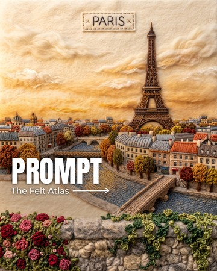

# 11 · The Felt Atlas



A 14-slide Instagram carousel of **handmade needle-felt and knitted-wool city posters**: world cities in one craft style, each with a small felt location tag at the top centre. Built for [@faceless.recipes](https://www.instagram.com/faceless.recipes/).

> **A stills prompt pack, not a reel workflow.** These are AI-generated textile artworks, not photographs of real places, and not anyone's confirmed process. No views or income are guaranteed.

## Costs at a glance
- **Estimated cost to make the 14 carousel stills yourself:** **~$0.80** (14 Nano Banana 2K stills at about $0.056 each, Nov 2026 list prices through OpenRouter; a style reference on later stills can add a few cents). Cover and CTA typography are added in any image editor, at no model cost. The 6 bonus city prompts are unused until you generate them.
- Prices change often; check the tool's pricing page.

---

**What you're making:** thirteen 4:5 felt city posters, plus typography on the Paris cover and a darkened Cape Town comment-CTA closer, posted as an Instagram carousel. The pack also includes 6 bonus city prompts, so you can offer 20 prompts in the caption.

**Why it works:** one consistent handmade look you can swipe through, a location tag on every slide, and a clear "comment GUIDE" prompt so people can get the pack.

> Invent your own cities if you want a different set. Label AI. These are textile artworks of well-known landmarks, not photographs.

---

## What you need
- **Nano Banana** (`google/gemini-nano-banana-2.1`) for every city still
- Any editor that can composite typography (Photoshop, Photopea, even Preview / Photos is enough)

Settings for every still: **4:5**, **2K**, then downscale to **1080×1350**. No typography in the model prompt except the felt location tag.

Optional but helpful: after you have one slide you like, send it back as a **style reference** and tell the model to keep that exact needle-felt and knitted-wool craft while changing the city. That is how this set stayed consistent.

I ran the stills through **OpenRouter**. The model's own app works just as well.

---

## Shared style prompt

Start every location with this exact block, then add the location lines below. Ask for the felt tag to use the exact spelling given.

```
Full-bleed needle-felt and knitted-wool diorama, photographed straight-on so the artwork fills the entire frame to all four edges. NO picture frame, NO shadow-box, NO deckled paper border, NO white studio margin, NO mount, NO mat, NO poster edge. Handmade textile art: punched needle-felt wool with visible fibre and roving, chunky knitted and crocheted stitches (stockinette water, garter-stitch roofs, loopy French-knot flowers, merino and alpaca texture). A lush tactile wool foreground frames a dense midground and ONE iconic landmark in the distance. Warm, saturated colours, creamy felted-wool sky with soft wool clouds. Clearly a needle-felted knitted diorama, not a paper-cut, not embroidered paper, not cut card, not a photoreal photograph, not a 3D render of a real place. No logos, no typography other than the location label, no watermark, no caption, no word PROMPT, no flags with readable text. At the TOP CENTRE only, a small rectangular knitted or felt tag with a stitched border, the city name in neat embroidered or knitted capital letters, a tiny felt X or stitch mark on each side of the name, spelled exactly as given below and fully readable. Do not place a label at the bottom. Vertical 4:5 portrait. Generous creamy wool sky in the upper third for the top-centre tag.
```

If a label is missing, misspelled, or unreadable, generate that slide once more. Check the spelling before you post. Keep the artwork full bleed — never add a frame or border in post.

---

## The 20 city prompts

Each one is: shared style block + the lines below.

### 1 · Paris (cover plate)
```
Location label text, spell exactly: "PARIS". City: Paris, France, late golden hour. Lush needle-felt foreground of wool roses, ivy and a stone-wool balcony or quay edge. Dense midground of knitted zinc rooftops and the Seine in stockinette stitch. ONE landmark: the Eiffel Tower in punched felt, warm and iconic, rising into a creamy merino sky. Small top-centre felt tag reading PARIS.
```

The cover uses this plate with typography composited on top (see Cover overlay).

### 2 · New York
```
Location label text, spell exactly: "NEW YORK". City: New York, USA, late afternoon light. Lush needle-felt foreground of wool autumn foliage and a knitted waterfront or park rail. Dense midground of the harbour in stockinette stitch. ONE landmark: the Statue of Liberty in punched felt with the Lower Manhattan wool skyline behind her, warm saturated colours, creamy merino sky. Small top-centre felt tag reading NEW YORK.
```

### 3 · London
```
Location label text, spell exactly: "LONDON". City: London, England, late golden hour. Lush needle-felt foreground of wool roses, ivy and a stone-wool river wall. Dense midground of the Thames in stockinette stitch and wool terraced facades. ONE landmark: Tower Bridge in punched felt, warm and clearly recognizable, creamy merino sky. Small top-centre felt tag reading LONDON.
```

### 4 · Dubai
```
Location label text, spell exactly: "DUBAI". City: Dubai, United Arab Emirates, warm golden evening. Lush needle-felt foreground of wool date palms, felt lanterns and a knitted terrace. Dense midground of the waterfront in stockinette stitch. ONE landmark: the Burj Khalifa in punched felt, slim and iconic, with a wool city around its base, no text on any building, creamy merino sky. Small top-centre felt tag reading DUBAI.
```

### 5 · Istanbul
```
Location label text, spell exactly: "ISTANBUL". City: Istanbul, Turkey, warm golden evening. Lush needle-felt foreground of wool tulips, hanging felt lanterns and a knitted terrace edge. Dense midground of the Bosphorus in stockinette stitch and a hill of wool houses. ONE landmark: the Blue Mosque (Sultan Ahmed Mosque) in punched felt, domes and minarets clear, creamy merino sky. Small top-centre felt tag reading ISTANBUL.
```

### 6 · Sydney
```
Location label text, spell exactly: "SYDNEY". City: Sydney, Australia, late afternoon light. Lush needle-felt foreground of wool waratah flowers, coastal foliage and a knitted harbour edge. Dense midground of the harbour in stockinette stitch. ONE landmark: the Sydney Opera House in punched white felt, sails clear and iconic, creamy merino sky. No text on the building. Small top-centre felt tag reading SYDNEY.
```

### 7 · Rio de Janeiro
```
Location label text, spell exactly: "RIO". City: Rio de Janeiro, Brazil, late golden hour. Lush needle-felt foreground of tropical wool foliage, felt hibiscus and a knitted hillside edge. Dense midground of the bay in stockinette stitch and wool city. ONE landmark: Christ the Redeemer in punched felt on a wool peak, clearly recognizable, warm saturated colours, creamy merino sky. Small top-centre felt tag reading RIO.
```

### 8 · Barcelona
```
Location label text, spell exactly: "BARCELONA". City: Barcelona, Spain, warm late afternoon. Lush needle-felt foreground of wool bougainvillea, citrus and a knitted balcony. Dense midground of wool Eixample rooftops. ONE landmark: the Sagrada Família in punched felt, the tall spires clearly recognizable, no text, creamy merino sky. Small top-centre felt tag reading BARCELONA.
```

### 9 · Cairo
```
Location label text, spell exactly: "CAIRO". City: Cairo, Egypt, late golden hour. Lush needle-felt foreground of wool date palms, lotus and a knitted terrace. Dense midground of the wool city and the Nile in stockinette stitch. ONE landmark: the Pyramids of Giza in punched felt on the horizon, warm desert light, creamy merino sky. Small top-centre felt tag reading CAIRO.
```

### 10 · Singapore
```
Location label text, spell exactly: "SINGAPORE". City: Singapore, warm early evening. Lush needle-felt foreground of wool orchids, tropical foliage and a knitted waterfront rail. Dense midground of the bay in stockinette stitch. ONE landmark: a three-tower waterfront skyline with a long sky-park joining the tops, punched felt, no text or logos on any building, creamy merino sky. Small top-centre felt tag reading SINGAPORE.
```

### 11 · Bangkok
```
Location label text, spell exactly: "BANGKOK". City: Bangkok, Thailand, warm golden evening. Lush needle-felt foreground of wool lotus flowers, orchids and a knitted river edge. Dense midground of the Chao Phraya in stockinette stitch. ONE landmark: Wat Arun, the Temple of Dawn, in punched felt, spire clear and iconic, creamy merino sky. No text. Small top-centre felt tag reading BANGKOK.
```

### 12 · San Francisco
```
Location label text, spell exactly: "SAN FRANCISCO". City: San Francisco, USA, late afternoon. Lush needle-felt foreground of wool hydrangeas, cypress and a knitted cliff edge. Dense midground of the bay in stockinette stitch and a fog-soft wool city. ONE landmark: the Golden Gate Bridge in punched rust-red felt, clearly recognizable, creamy merino sky. The label may be two lines, SAN / FRANCISCO. Small top-centre felt tag reading SAN FRANCISCO.
```

### 13 · Athens
```
Location label text, spell exactly: "ATHENS". City: Athens, Greece, late golden hour. Lush needle-felt foreground of wool olive branches, bougainvillea and a knitted stone terrace. Dense midground of the wool city on the hills. ONE landmark: the Acropolis with the Parthenon in punched felt, clearly recognizable, creamy merino sky. Small top-centre felt tag reading ATHENS.
```

### 14 · Cape Town (CTA plate)
```
Location label text, spell exactly: "CAPE TOWN". City: Cape Town, South Africa, late golden hour. Lush needle-felt foreground of wool protea flowers, fynbos and a knitted waterfront edge. Dense midground of the bay in stockinette stitch. ONE landmark: Table Mountain in punched felt, the flat summit unmistakable, warm saturated colours, creamy merino sky. Small top-centre felt tag reading CAPE TOWN.
```

Darken this plate and composite the CTA typography on top (see CTA slide).

### 15 · Prague (bonus)
```
Location label text, spell exactly: "PRAGUE". City: Prague, Czechia, late golden hour. Lush needle-felt foreground of wool ivy, lanterns and a stone-wool bridge parapet. Dense midground of the Vltava in stockinette stitch. ONE landmark: Charles Bridge leading to a punched-felt castle on the hill, creamy merino sky. Small top-centre felt tag reading PRAGUE.
```

### 16 · Amsterdam (bonus)
```
Location label text, spell exactly: "AMSTERDAM". City: Amsterdam, Netherlands, late afternoon. Lush needle-felt foreground of wool tulips, bicycles suggested in felt (no logos) and a knitted canal edge. Dense midground of a canal in stockinette stitch. ONE landmark: a row of punched-felt gabled canal houses and a humpback wool bridge, creamy merino sky. Small top-centre felt tag reading AMSTERDAM.
```

### 17 · Seoul (bonus)
```
Location label text, spell exactly: "SEOUL". City: Seoul, South Korea, late afternoon. Lush needle-felt foreground of wool pine, hanbok-coloured felt blossoms and a knitted hillside. Dense midground of the wool city. ONE landmark: N Seoul Tower on a punched-felt mountain, or Bukchon hanok rooftops with the tower in the distance, no text, creamy merino sky. Small top-centre felt tag reading SEOUL.
```

### 18 · Vienna (bonus)
```
Location label text, spell exactly: "VIENNA". City: Vienna, Austria, late golden hour. Lush needle-felt foreground of wool roses, ironwork and a knitted garden edge. Dense midground of formal gardens. ONE landmark: Schönbrunn Palace or St Stephen's Cathedral in punched felt, no text, creamy merino sky. Small top-centre felt tag reading VIENNA.
```

### 19 · Mumbai (bonus)
```
Location label text, spell exactly: "MUMBAI". City: Mumbai, India, warm evening. Lush needle-felt foreground of wool bougainvillea, a knitted waterfront promenade. Dense midground of the harbour in stockinette stitch. ONE landmark: the Gateway of India in punched felt, clearly recognizable, no text, creamy merino sky. Small top-centre felt tag reading MUMBAI.
```

### 20 · Buenos Aires (bonus)
```
Location label text, spell exactly: "BUENOS AIRES". City: Buenos Aires, Argentina, late afternoon. Lush needle-felt foreground of wool jacaranda or tango-coloured flowers and a knitted street edge. Dense midground of a cobbled wool street. ONE landmark: the colourful painted houses of La Boca / Caminito in punched felt, or the Obelisco in the distance, no text, creamy merino sky. The label may be two lines, BUENOS / AIRES. Small top-centre felt tag reading BUENOS AIRES.
```

---

## Cover overlay (slide 1)

Composite this on the Paris plate, in the lower left. Do not bake it into the model prompt.

If the lower-left midground is a light cream quay or path, add a **soft dark gradient or shadow** behind the type so the subtitle stays readable — not a hard black box.

- Huge bold white **PROMPT** (heavy gothic sans, e.g. Anton / Archivo Black)
- Smaller white **The Felt Atlas** with a long thin arrow to the right

The felt **PARIS** tag stays at the top centre. No handle, no URL.

## CTA slide (slide 14)

Darken the Cape Town plate (a warm black veil, strong enough that white type pops, with the felt scene still visible) and composite typography in white plus one warm gold accent:

- Huge white **COMMENT**
- Huge gold **"GUIDE"** (quotes included)
- Two smaller white lines: **I'LL SEND YOU** / **ALL THE PROMPTS**
- Small tracked caps: **SAVE · STEAL · CREATE**
- A thin gold L-shaped accent line (short vertical, then horizontal)

The felt **CAPE TOWN** tag can stay at the top centre. The keyword is **GUIDE**. On @faceless.recipes, commenting GUIDE sends a DM with a link to this repo.

---

## Suggested caption

```
20 cities, handmade from felt and wool 🧶

Comment GUIDE for all 20 prompts 💬

Every poster built by hand 👇
🧶 Needle-felted wool fibre
🧵 Knitted water and rooftops
🌸 Felt flowers in the foreground

Paris · New York · London · Dubai · Istanbul
+ 15 more → same light, same wool, one collection.

Made with Nano Banana

Save this and find your city.

Follow @faceless.recipes for free prompts and a faceless channel breakdown every day

Comment GUIDE for all 20 prompts 💬

AI-generated art.

#aiprompts #claudeai #paris #newyork #london
```

---

## Good to know
- Always label AI content.
- These are textile artworks of well-known landmarks, not photographs of real places.
- Check every felt tag for spelling before you post.
- Keep every slide full bleed — no frame or border.
- Views are not income. Results are not guaranteed.
