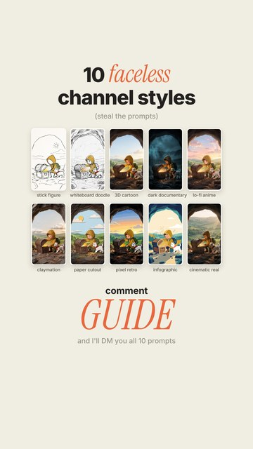

# 12 · 10 Faceless Channel Styles



A 15-second reel showing **one scene redrawn in the 10 visual styles faceless YouTube channels use**:

1. stick figure
2. whiteboard doodle
3. 3D cartoon
4. dark documentary
5. lo-fi anime
6. claymation
7. paper cutout
8. pixel retro
9. infographic
10. cinematic real

Built for [@faceless.recipes](https://www.instagram.com/faceless.recipes/). Pick a style, swap in your own character and topic, and you have the look for a channel.

> These are AI-generated images and clips. They're our own rebuild of a popular "10 styles, one prompt each" reel format, not any channel's confirmed process. No views or income are guaranteed.

## Costs at a glance
These are the real costs of this reel, at Nov 2026 OpenRouter list prices. Prices change, so check each tool's pricing page.

| Item | Qty | Cost |
|---|---|---|
| Nano Banana 2K stills (1 master + 9 styles) | 10 | ~$0.55 |
| Re-dos (stick figure, claymation, pixel retro needed a stronger prompt) | 3 | ~$0.17 |
| Veo 3.1 Lite image-to-video, 720p, 4 s, no audio | 5 clips | $0.60 |
| Voiceover (11 short lines) | 1 | ~$0.01 |
| **Total** | | **~$1.33** |

- You can skip all video. Gently zooming and panning the stills in your editor costs $0 and looks fine for flat styles.
- One finished still in a single style costs about **$0.055**.

---

## What you need
- **Nano Banana** (`google/gemini-nano-banana-2.1`) for the stills. Settings: **9:16**, **2K**. The output came back at 1536×2752.
- **Veo 3.1 Lite** (`google/veo-3.1-lite`) or **Kling** for motion. Settings: image-to-video, the still as the first frame, **9:16**, **720p**, **4 s**, audio off.
- **Claude** (optional) to write a scene description for your own channel topic (prompt below).
- **CapCut**, or any editor, to put the reel together.
- A voice (optional). We used a TTS voice that reads each style name.

We ran the image and video models through **OpenRouter**. Their own apps work just as well.

---

## How it works (the consistency trick)
1. **Make one master image** in the 3D cartoon style from a detailed scene prompt.
2. **Make the other 9 styles from that master.** Attach the master as the reference image and tell the model to *redraw this exact scene* in the new style. This keeps the same characters, pose and layout in every style, which is what makes the comparison satisfying.
3. If a style comes back looking too much like the master, which happened with stick figure, claymation and pixel art, use a **"completely restyle / completely redraw"** prompt that describes every element in the new medium.
4. Animate the styles where motion matters (3D, dark doc, anime, clay, cinematic). Zoom and pan the flat ones.

---

## The keep block (put it before each style line)
```
Redraw this exact scene: same composition and camera angle, same explorer in the mustard-yellow hooded raincoat lifting the lid of the glowing wooden treasure chest, same little white terrier with a red scarf, same cave mouth with the sunny valley behind, characters centred in the middle third, full body visible. Keep the same colours for the coat, scarf and chest where the style allows. Vertical 9:16. No text, no letters, no logos, no watermark, no border, no frame. Render it entirely in this style: 
```

## The 10 style prompts
### 01 · Stick figure
*Good for: explainers, money/psychology facts, "what if" questions.*  
Attach the master image as the reference and send this full prompt. (The short "keep + style" version left too much of the 3D look, so this one restyles the whole picture.)
```
Completely restyle this picture as a minimalist stick-figure explainer frame. The explorer becomes a true stick figure: a plain white circle head with no face at all, the body, arms and legs drawn as single thick black lines, wearing only a simple flat mustard-yellow triangle hood and cape shape. The dog becomes a simple doodle dog made of a few black lines with a red scarf line. The treasure chest is a simple black-outlined box with a flat gold glow. Background: plain off-white paper with just a few loose black marker lines for the cave arch and a tiny sun. Thick uniform black marker lines, flat colour, lots of white space, the look of a popular faceless stick-figure YouTube explainer channel. Same composition: characters centred in the middle third. Vertical 9:16. No text, no letters, no border.
```

### 02 · Whiteboard doodle
*Good for: education, business breakdowns, how-it-works.*  
Attach the master image as the reference. Send the **keep block** followed by:
```
a whiteboard animation doodle style: black dry-erase marker line drawing on a bright white whiteboard, hand-sketched with confident strokes and cross-hatching, a few touches of colour marker (yellow coat, red scarf, orange glow lines around the chest), a faint marker smudge, the look of a whiteboard explainer video frame.
```

### 03 · 3D cartoon (master)
*Good for: "what if" history, kids stories, cute shorts.*  
Generate this first, with no reference image:
```
Vertical 9:16 illustration in polished 3D cartoon animation style (soft Pixar-like family film render, rounded shapes, subsurface skin, soft global illumination, warm golden-hour light). Scene: a small young explorer in a mustard-yellow hooded raincoat with the hood up, olive cargo pants, brown boots and a small green backpack, kneeling and lifting the lid of an old wooden treasure chest that spills warm golden light onto their face. Beside them a scruffy little white terrier dog with a red scarf peers into the chest, tail up. They are at the mouth of a rocky cave, with a glimpse of a sunny green valley and blue sky with a few soft clouds through the cave opening behind them. Both characters and the chest are centred in the middle third of the frame, full body visible, with clear empty-ish sky at the top and rocky ground at the bottom. Clean, readable silhouettes, bright saturated colours. No text, no letters, no logos, no watermark, no border.
```
Motion prompt (image-to-video, first frame = this still):
```
The explorer slowly lifts the chest lid higher and golden light and sparkles rise out of the chest onto their delighted face; the little white dog wags its tail and leans in. Gentle slow push-in camera. Keep the 3D cartoon animation style. No text.
```

### 04 · Dark documentary
*Good for: true mystery, unsolved cases, creepy history.*  
Attach the master image as the reference. Send the **keep block** followed by:
```
a dark cinematic mystery documentary style: photoreal moody night-time scene lit only by the eerie golden glow from the chest, deep shadows, cold blue-teal fog drifting out of the cave, film grain, shallow depth of field, anamorphic lens look, desaturated except the warm glow, like a true-mystery documentary channel.
```
Motion prompt (image-to-video, first frame = this still):
```
Slow ominous push-in. Teal fog drifts out of the cave, the golden glow from the chest flickers on the explorer's face as they lift the lid, dust particles float in the light beam, the dog's ears twitch. Moody cinematic documentary look, film grain. No text.
```

### 05 · Lo-fi anime
*Good for: motivation, storytime, study/relax channels.*  
Attach the master image as the reference. Send the **keep block** followed by:
```
a lo-fi anime style: soft hand-painted 1990s anime cel look, warm sunset pastel palette with pink and orange sky, gentle light leaks, slightly grainy and cosy, Studio-style painted background of the valley, clean anime character line art, calm lo-fi study-beats mood.
```
Motion prompt (image-to-video, first frame = this still):
```
Calm lo-fi anime loop: the explorer's hood and the dog's red scarf flutter in a soft breeze, clouds drift slowly across the pink sunset sky, sparkles float up from the glowing chest, gentle light leak shimmer. Static camera. Keep the hand-painted anime style. No text.
```

### 06 · Claymation
*Good for: cosy shorts, food, quirky stories.*  
Attach the master image as the reference and send this full prompt. (The short "keep + style" version left too much of the 3D look, so this one restyles the whole picture.)
```
Completely remake this scene as a real handmade claymation stop-motion photograph, like an Aardman-style tabletop set. The explorer and the dog are chunky plasticine puppets with exaggerated simple shapes, big round clay eyes, visible fingerprints, thumb smudges and sculpting-tool marks on every surface; the coat is lumpy mustard-yellow clay, the dog is white clay with a red clay scarf. The chest is sculpted clay with a little yellow clay glow. The cave arch and rocks are grey-brown clay lumps, the valley behind is a painted miniature backdrop with cotton-wool clouds. Photographed with a macro lens, shallow depth of field, small studio lights, obviously a miniature set and not a CGI render. Same composition, characters centred in the middle third, full body. Vertical 9:16. No text, no letters, no border.
```
Motion prompt (image-to-video, first frame = this still):
```
Stop-motion claymation animation at 12 frames per second with slight jitter: the clay explorer lifts the chest lid, little clay sparkles pop up, the clay dog wags its tail and tilts its head. Static camera on a miniature set. Keep the plasticine look. No text.
```

### 07 · Paper cutout
*Good for: travel, geography, history explainers.*  
Attach the master image as the reference. Send the **keep block** followed by:
```
a layered paper-cutout craft style: every element is cut from coloured card and paper, stacked in layers with soft drop shadows between them, visible paper texture and slightly rough scissor-cut edges, a paper sun and paper clouds, warm saturated colours, like a handmade paper diorama.
```

### 08 · Pixel retro
*Good for: game lore, retro history, nerdy facts.*  
Attach the master image as the reference and send this full prompt. (The short "keep + style" version left too much of the 3D look, so this one restyles the whole picture.)
```
Completely redraw this scene as low-resolution 16-bit pixel art, as if upscaled from a 160x284 pixel game screen with nearest-neighbour scaling: every element made of big chunky square pixels clearly visible, hard pixel edges, no smooth gradients, no anti-aliasing, a limited 24-colour bright SNES palette, dithered sky, pixel clouds, pixel sun, pixel-art cave arch, a tiny pixel-art explorer sprite in a mustard-yellow hood and a little white pixel dog with a red scarf next to a pixel treasure chest with sparkling pixel stars. Same composition, characters centred in the middle third. Vertical 9:16. No text, no HUD, no letters, no border.
```

### 09 · Infographic
*Good for: data, finance, comparisons.*  
Attach the master image as the reference. Send the **keep block** followed by:
```
a flat vector motion-graphics infographic style: clean geometric flat shapes, no outlines, limited modern palette of mustard, coral, teal and navy on a soft cream background, simple long shadows, the chest glow as clean radiating lines, a few abstract circles and simple dotted path lines as decoration, like a data-explainer YouTube channel (absolutely no numbers or text).
```

### 10 · Cinematic real
*Good for: documentary b-roll, nature, history recreations.*  
Attach the master image as the reference. Send the **keep block** followed by:
```
a photoreal cinematic live-action film style: a real child-sized explorer in a mustard-yellow hooded raincoat and a real white terrier with a red scarf, shot on a 35mm cinema camera at golden hour, natural light streaming into the rocky cave, realistic textures, warm volumetric light rays, shallow depth of field, like premium AI b-roll for a documentary.
```
Motion prompt (image-to-video, first frame = this still):
```
Cinematic live-action shot: the child explorer opens the treasure chest, warm golden light spills out across their face and the terrier's fur, the dog wags its tail and sniffs inside, dust motes float in volumetric light rays. Slow dolly-in, 35mm film look. No text.
```

---

## Make it your own (Claude scene writer)
Paste this into Claude, then use its answer as your master prompt:
```
I run a faceless YouTube channel about [TOPIC]. Write one image-generation prompt for a single vertical 9:16 scene that represents my channel: one or two recurring characters with very specific clothing colours, one clear action, one simple setting, characters centred in the middle third, full body visible, no text. Describe it in a polished 3D cartoon style. Under 120 words. Then list 10 one-line style descriptions I could restyle it into (stick figure, whiteboard, 3D cartoon, dark documentary, lo-fi anime, claymation, paper cutout, pixel art, flat infographic, photoreal cinematic), each saying what the characters and setting are made of in that style.
```

---

## Rebuild the reel layout (15 s, 1080×1920, 30 fps)
- **Background:** flat cream `#F0EDE2`.
- **Title,** top centre and below the top 250 px: "10 *faceless* / channel styles".
  - Bold black sans (Inter ExtraBold, `#23211F`).
  - The accent word is italic serif (Instrument Serif Italic) in orange `#EA673D`.
  - Small grey "(steal the prompts)" underneath.
- **Left:** a numbered list 01–10. The current style is orange, finished ones are dark grey, and upcoming ones show only the number.
- **Right:** a rounded 9:16 card (about 500×890 px, 30 px corners, 7 px off-white border, soft shadow) playing the current style.
- **Timing:**
  - Each style lasts **35 frames (1.17 s)**.
  - Between styles there's a **10-frame wipe inside the card** that matches the next style: marker lines before whiteboard, film burn before dark doc, cloud puffs before claymation, a torn-paper edge before paper cutout, a pixel dissolve before pixel art, colour bars before infographic, and plain panel slides for the rest.
- **End card (11.7–15 s):**
  - A hard cut to a 5×2 grid of all 10 stills with labels, which pop in one after another.
  - Then "comment / **GUIDE** (big orange italic serif) / and I'll DM you all 10 prompts".
- **Audio:**
  - The voice reads each style name as it appears, then "Comment guide, and I'll DM you all ten prompts."
  - A light music bed underneath, plus soft swooshes on the wipes.
  - Loudness is normalised to −14 LUFS.
- Keep all text out of Instagram's top 250 px, below y ≈ 1540, and away from the right-hand button column.

## Troubleshooting
- **Characters change between styles:** always attach the master as the reference, and keep "same composition, same characters centred" in the prompt.
- **A style looks like the master with a filter:** switch to a "completely restyle" prompt that says what everything is made of (clay, card, pixels, marker lines).
- **Text or letters appear in the image:** keep "No text, no letters, no logos" at the end of every prompt, and re-run once.
- Label your posts as AI-generated.
