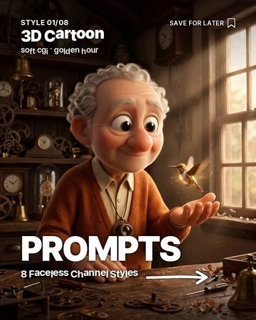

# 15 · 8 Faceless Channel Styles



A 9-slide Instagram carousel of **eight faceless YouTube styles, each with its own scene and characters**, plus a comment-CTA closer. Built for [@faceless.recipes](https://www.instagram.com/faceless.recipes/).

1. 3D cartoon — a Pixar-like clockmaker and an automaton hummingbird
2. Claymation — a plasticine barber trimming a nervous clay lion
3. Lo-fi anime — a girl on a sunset tram
4. Dark documentary — a researcher in a foggy ruined archive
5. Paper cutout — a paper fox crossing a card bridge
6. Pixel retro — a 16-bit adventurer on a cliff at dusk
7. Infographic — a flat-vector bicycle courier
8. Cinematic real — an archaeologist in a golden-hour canyon
9. CTA — comment **GUIDE** for all 8 prompts

> These are AI-generated images and clips. They're our own rebuild of a popular "styles, one prompt each" carousel format, not any channel's confirmed process. No views or income are guaranteed.

## Costs at a glance
These are the real costs of this carousel, at Nov 2026 OpenRouter list prices. Prices change, so check each tool's pricing page.

| Item | Qty | Cost |
|---|---|---|
| Nano Banana 2K stills, 4:5 (8 used, plus 2 unused cover/clay candidates) | 10 | ~$0.55 |
| Veo 3.1 Lite image-to-video, 720p, 4 s, no audio | 8 | $0.96 |
| CTA (darkened cover clip + typography, no new model job) | 0 | $0 |
| **Total** | | **~$1.51** |

- To remake it yourself with one still per style: **8 stills (~$0.44) + 8 clips ($0.96) ≈ $1.40**.
- You can skip video on the flatter styles (paper, pixel, infographic) and gently zoom them in your editor for $0.
- One finished still in a single style costs about **$0.055**.

---

## What you need
- **Nano Banana** (`google/gemini-nano-banana-2.1`) for the stills. Settings: **4:5**, **2K**. Ours came back at 1856×2304.
- **Veo 3.1 Lite** (`google/veo-3.1-lite`) for motion. Settings: image-to-video, the still as the first frame, **9:16**, **720p**, **4 s**, audio off. Veo Lite does not accept 4:5, so pad the still first (see Motion, below).
- Any editor that can composite typography and crop a 9:16 clip back to **1080×1350**.
- **Claude** (optional) to invent your own scene in one of these styles (prompt at the end).

We ran the image and video models through **OpenRouter**. Their own apps work just as well.

---

## How it works
Unlike [guide 12](../12-faceless-channel-styles/README.md), this set does **not** restyle one scene eight times. Each slide is a different scene, with different characters, built as a textbook example of that medium — the way a strong styles carousel reads at a glance.

1. Write a still prompt that forces the medium's tell-tale signatures (fingerprints for clay, inked cels for anime, chunky pixels for 16-bit, and so on) and keeps a **darker or busier upper-left** so white labels can sit there.
2. Generate at **4:5**, 2K. If a style comes back looking like a filter on 3D CGI, rewrite the prompt so it says what everything is *made of*, and run it once more.
3. Animate with Veo. Keep the composition. Ask clay and paper for stepped, handmade motion, and ask pixel and infographic not to smooth into HD or 3D.
4. Composite the typography in your editor. The cover also gets `PROMPTS` / `8 Faceless Channel Styles` / `SAVE FOR LATER`. The last slide is a darkened cover clip with the GUIDE CTA.

## The keep block (start every still with this)

```
Portrait 4:5 still, full-bleed, no border, no frame, no text, no letters, no logos, no watermark.

IMPORTANT composition: leave a darker or busier area in the UPPER LEFT of the frame so white title typography can sit there and stay readable.
```

The eight prompts below already include that block, so you can paste each one as-is.

---

## The 8 style prompts

### 01 · 3D Cartoon (cover)
*Good for: "what if" history, kids stories, cute shorts.*  
Label: `STYLE 01/08` / `3D Cartoon` / `soft cgi · golden hour`

```
Portrait 4:5 still, full-bleed, no border, no frame, no text, no letters, no logos, no watermark.

A polished 3D feature-animation frame at Pixar / Disney Animation quality. An elderly clockmaker with a kind, highly appealing, stylized face: a large rounded head, huge glossy eyes with wet catchlights, a friendly rounded nose, rosy cheeks with visible subsurface scattering and soft peach-fuzz. Silver curly hair, a warm rust cardigan over a cream shirt, a leather jeweller's loupe on a cord. He is not photoreal — he is a cartoon character from a prestige family film.

He stands at a worn wooden workbench, one palm open. A tiny exquisite brass-and-porcelain automaton hummingbird hovers just above his hand, wings shimmering, a faint golden glow in its chest. He looks at it with quiet delight.

Setting: a richly cluttered clock workshop. IMPORTANT composition: the UPPER LEFT of the frame is darker and busy — deep walnut shelves packed with clocks, gears, brass bells and glass domes — so white title typography can sit there and stay readable. Late-afternoon golden light pours through a dusty mullioned window on the right, with soft volumetric rays, dust motes, and soft global illumination. The LOWER THIRD is the workbench surface: darker worn wood, shavings, cogs and tiny screwdrivers, a slightly darker textured area.

Rounded appealing shapes, cinematic camera just below eye-level, shallow but readable depth of field, beautiful amber-walnut-brass-cream color script. Feature-animation materials only: no photoreal pores, no clay, no fingerprints, no stop-motion, no paper cutout, no anime lineart, no illustration. Lush, finished, hook-worthy cover frame.
```

Motion prompt (image-to-video, first frame = this still):
```
Gentle loopable 4-second motion, keep this exact composition, camera angle, characters and framing. The brass-and-porcelain automaton hummingbird hovers in place above the clockmaker's open palm with a rapid, gentle wing buzz and a few tiny sparkles; the clockmaker's eyes follow it and his smile deepens slightly; dust motes drift slowly in the golden window light; a clock pendulum in the background swings. Almost-static camera, only the tiniest breathing. Keep the polished 3D Pixar-like cartoon style, soft global illumination, subsurface-scattering skin. No text, no letters, no logos, no watermark, no new objects, no camera orbit.
```

### 02 · Claymation
*Good for: cosy shorts, food, quirky stories.*  
Label: `STYLE 02/08` / `Claymation` / `plasticine · fingerprints · handmade`

```
Portrait 4:5 still, full-bleed, no border, no frame, no text, no letters, no logos, no watermark.

This must look like a PHOTOGRAPH of a REAL tabletop stop-motion puppet set, as if a frame from an Aardman or Laika film shot on a physical set with a real camera. It must NOT look like 3D CGI, NOT like a Pixar film, NOT like a clay shader on a smooth digital character, NOT like subsurface-scattering skin, NOT perfectly symmetric.

A plasticine barber: a lumpy man with a huge clay moustache made of tooled clay hairs, fingerprint-covered face and hands, a slightly lopsided clay nose, a pale clay apron over a striped clay shirt. He holds a clay comb and tiny scissors and is carefully trimming the fringe of a nervous clay lion sitting in the barber chair, wrapped in a real felt cutting cape. The lion's mane is thick plasticine sausages with fingerprints and tool marks, wide slightly uneven clay eyes glancing sideways, one crooked whisker.

CRITICAL style signatures, front and centre: visible fingerprint ridges in the barber's cheeks, forehead and hands, thumbprints, clay seams, slightly melted-looking forms, matte plasticine with only a soft waxy sheen.

Setting: a tiny cardboard barbershop — painted cardboard wallpaper, a real miniature mirror, a felt rug, a hanging practical bulb, a clay goldfish bowl. IMPORTANT composition: the UPPER LEFT is a dark wooden shelf crowded with lumpy clay tonic bottles, so white title typography can sit there and stay readable.

Shot as a real miniature: tilt-shift lens, shallow miniature depth of field, tabletop stop-motion lighting, slight film grain, obviously handmade scale. No CGI smoothness, no perfect skin, no Pixar eyes, no digital subsurface scattering.
```

Motion prompt:
```
Stop-motion claymation animation at 12 frames per second with slight handmade frame-by-frame jitter and occasional held frames, as if photographed on a real tabletop puppet set. Keep this exact composition, camera angle, characters and framing. The clay barber's scissors and comb make small, stepped snips at the lion's mane; one small clay lock of mane is trimmed and drops; the lion's eyes shift sideways in a stepped blink and its nervous expression holds still between frames; the hanging bulb sways a fraction. Static camera. Keep the plasticine look: visible fingerprints, lumpy handmade forms, matte clay with a soft waxy sheen, felt cape, cardboard set. Do NOT smooth the motion into fluid CGI and do not change the materials. No text, no letters, no logos, no watermark, no new objects.
```

### 03 · Lo-fi Anime
*Good for: motivation, storytime, study/relax channels.*  
Label: `STYLE 03/08` / `Lo-fi Anime` / `hand-painted cel · sunset pastels`

```
Portrait 4:5 still, full-bleed, no border, no frame, no text, no letters, no logos, no watermark.

A 1990s hand-painted anime cel, classic television / Studio-style quality. This must NOT look like 3D CGI, NOT like modern AI-smooth 3D-anime, NOT photoreal, NOT a Pixar frame. Clean character line art with visible inked outlines and painted cel shading. The background is a soft gouache-like painted backdrop.

A teenage girl about sixteen, dark hair in a loose bob, simple cream earbuds, a rust-orange knit cardigan over a white shirt, forehead resting gently against the window of a vintage yellow tram at sunset. A calm, slightly wistful expression, one hand on the glass. Warm sunset light paints her face in peach and gold.

Outside the window: a painted city of tiled roofs sliding by, cherry-blossom trees in soft pink, a pastel orange-pink-lavender sunset sky, a few flat painted clouds, a gentle light leak and a little film grain. Cosy lo-fi study-beats mood.

IMPORTANT composition: the UPPER LEFT of the frame is the darker tram interior — a shadowed dark-wood or dark-green painted tram wall and a hanging hand-strap — so white title typography can sit there and stay readable. The girl sits mid-right, the glowing window occupies the right half. Lush, finished, full-bleed frame.
```

Motion prompt:
```
Gentle loopable 4-second motion, keep this exact composition, camera angle, characters and framing. Calm lo-fi anime loop: cherry-blossom trees and the painted tiled-roof city drift slowly past the tram window, a soft light leak shimmers, her earbud cord and a strand of hair shift slightly, sunset glow breathes on her face. Almost-static camera. Keep the hand-painted 1990s anime cel look with visible inked outlines and a gouache background. Do not turn this into 3D CGI. No text, no letters, no logos, no watermark, no new objects.
```

### 04 · Dark Documentary
*Good for: true mystery, unsolved cases, creepy history.*  
Label: `STYLE 04/08` / `Dark Documentary` / `moody cinema · fog · film grain`

```
Portrait 4:5 still, full-bleed, no border, no frame, no text, no letters, no logos, no watermark.

A photoreal cinematic documentary still, as if a frame from a true-mystery television documentary. NOT cartoon, NOT clay, NOT anime, NOT illustration, NOT stylized 3D.

A lone field researcher, a woman in her forties, weathered olive raincoat, damp natural hair, photoreal natural skin. She stands in a ruined stone archive at night. Her flashlight cuts a warm cone through thick teal fog; dust and paper motes hang in the beam. A rusted filing cabinet is half-open in the light, yellowed folders spilling. Wet stone floor, collapsed wooden shelves, a broken arched window with cold moonlight.

Mood: anamorphic feel, visible film grain, deep crushed shadows, desaturated except the warm flashlight and the cold teal fog, shallow depth of field.

IMPORTANT composition: the UPPER LEFT is dark architecture — a shadowed stone wall and the upper edge of a collapsed shelf, almost black — so white title typography can sit there and stay readable. The researcher and the flashlight beam sit mid-frame, not covering the top-left. Lush, finished, full-bleed.
```

Motion prompt:
```
Gentle loopable 4-second motion, keep this exact composition, camera angle, characters and framing. Very slight slow documentary push-in. Teal fog drifts through the flashlight beam, dust and paper motes float, the beam flickers almost imperceptibly, a folder in the rusted cabinet stirs. Keep the photoreal moody documentary look, film grain, crushed shadows, shallow depth of field. No text, no letters, no logos, no watermark, no new objects, no stylized cartoon.
```

### 05 · Paper Cutout
*Good for: travel, geography, kids stories, history explainers.*  
Label: `STYLE 05/08` / `Paper Cutout` / `cut card · stacked layers · scissors`

```
Portrait 4:5 still, full-bleed, no border, no frame, no text, no letters, no logos, no watermark.

A handmade paper-cut diorama, photographed as a physical stacked-card shadow box. EVERY element is cut from coloured card or construction paper. Visible paper fibre and cardstock texture, slightly rough scissor-cut edges, stacked layers with soft physical drop shadows between them. This must NOT look like a digital painting, NOT like 3D, NOT like watercolor, NOT like an illustration with a paper filter.

A small paper-craft fox in a little rust-red paper raincoat and a folded paper hat is crossing a bridge made of stacked strips of brown and tan card, toward a cut-paper village of simple house shapes with warm yellow punched-out windows, under a slightly lopsided cut-paper sun. Scissor-cut pine trees in overlapping layers, cotton-paper clouds, a felt or card path.

IMPORTANT composition: the UPPER LEFT is a darker card hillside or a deep forest-green cut-paper treeline in shadow, so white title typography can sit there and stay readable. The fox and the bridge sit in the lower-middle. Handmade, slightly imperfect cuts. Lush, finished, full-bleed.
```

Motion prompt:
```
Gentle loopable 4-second motion, keep this exact composition, camera angle, characters and framing. A cut-out paper animation feel: the paper fox takes two or three tiny stepped steps across the card bridge, a paper tree layer and a paper cloud shift a fraction, the paper sun holds. Soft drop shadows stay. Keep every element as cut coloured card with visible paper edges — do not morph into 3D, painting, or clay. Static camera. No text, no letters, no logos, no watermark, no new objects.
```

### 06 · Pixel Retro
*Good for: game lore, retro history, nerdy facts.*  
Label: `STYLE 06/08` / `Pixel Retro` / `16-bit · dithered sunset`

```
Portrait 4:5 still, full-bleed, no border, no frame, no text, no letters, no logos, no watermark, no HUD, no hearts, no menu, no numbers.

Crisp 16-bit SNES-era pixel art, as if a still from Secret of Mana or Chrono Trigger. Visible chunky pixels large enough to read as 16-bit at phone size, a limited bright palette, dithered sunset gradients, no anti-aliased smoothness, no photoreal, no 3D, no modern HD "pixel-inspired" look.

A 16-bit adventurer (short hero, blue cape, leather tunic, a small sword on the back) stands on a pixel cliff at dusk, looking out at a pixel castle on a distant crag and a small pixel airship in the sky. A pixel campfire with a few dithered flame pixels sits in the foreground. Dithered orange-purple-navy sunset, pixel pine trees and rocks.

IMPORTANT composition: the UPPER LEFT is a darker mass of pixel pine foliage or a dark cliff wall, so white title typography can sit there and stay readable. The sunset and castle sit on the right. Full-bleed pixel scene. Absolutely no typography in the picture.
```

Motion prompt:
```
Gentle loopable 4-second motion, keep this exact composition, camera angle, characters and framing. 16-bit sprite animation only: the campfire pixels flicker, the tiny airship drifts slowly, the adventurer's blue cape idle-animates a few pixels. CRITICAL: keep crisp chunky 16-bit pixels for the entire shot. Do not smooth, sharpen into HD, anti-alias, or turn this into a painterly or 3D scene. No HUD, no text, no letters, no numbers, no logos, no watermark. Static camera.
```

### 07 · Infographic
*Good for: data, finance, listicles, comparisons.*  
Label: `STYLE 07/08` / `Infographic` / `flat vector · long shadows`

```
Portrait 4:5 still, full-bleed, no border, no frame, no text, no letters, no logos, no watermark, no numbers, no charts, no typography of any kind.

A clean flat-vector motion-graphics infographic illustration. Geometric shapes only, no outlines, no soft painterly gradients, long sharp evening shadows, a limited palette of mustard, coral, teal and deep navy. The look of a polished faceless explainer thumbnail. NOT a 3D render, NOT a photograph, NOT a sketch, NOT a cartoon with outlines.

A flat-vector bicycle courier (simple geometric helmet, mustard jacket, coral messenger bag) is skidding to a stop on a teal street outside a geometric corner café with a simple awning and a flat cup-shape sign — the sign is a cup shape only, with NO letters. Long evening shadows stretch across the pavement. A few simple window rectangles and a flat plant pot.

CRITICAL composition: a deep navy building wall fills the UPPER LEFT and most of the upper half, so white title typography can sit on that dark navy and stay readable. Do not put a pale cream or bright sky behind the top-left. Lush, graphic, finished, full-bleed.
```

Motion prompt:
```
Gentle loopable 4-second motion, keep this exact composition, camera angle, characters and framing. A motion-graphics loop: the bicycle wheels rotate, the courier's long shadow creeps a fraction, a tiny graphic dust or leaf of flat colour drifts. Keep the image strictly flat vector — geometric shapes, no outlines, no 3D, no photoreal, no new letters or numbers. Almost-static camera. No text, no logos, no watermark.
```

### 08 · Cinematic Real
*Good for: documentary b-roll, nature, history recreations.*  
Label: `STYLE 08/08` / `Cinematic Real` / `35mm film · volumetric light`

```
Portrait 4:5 still, full-bleed, no border, no frame, no text, no letters, no logos, no watermark.

A photoreal live-action 35mm cinema still. NOT cartoon, NOT clay, NOT anime, NOT illustration, NOT plastic AI-smooth skin.

A real archaeologist, a man in his thirties, dusty linen shirt, leather satchel, natural skin with real pores and sun, kneeling at golden hour in a sandstone canyon alcove. Volumetric light rays pour through a gap in the rock. He holds a small bronze artefact that just catches the sun. Shallow depth of field, filmic colour, fine film grain, dust motes in the light, khaki and amber and cool shadow.

IMPORTANT composition: the UPPER LEFT is a darker rock wall in shade, so white title typography can sit there and stay readable. The figure and the light shaft sit mid-to-lower frame. Lush, finished, full-bleed.
```

Motion prompt:
```
Gentle loopable 4-second motion, keep this exact composition, camera angle, characters and framing. Dust motes drift in the volumetric light rays, the bronze artefact catches a slightly shifting glint, fabric on the shirt stirs, a very slow almost-breathing camera. Keep photoreal live-action 35mm cinema look, natural skin, shallow depth of field, film grain. No text, no letters, no logos, no watermark, no cartoon, no clay.
```

---

## Motion (4:5 stills into Veo)

Veo 3.1 Lite wants **9:16**. To keep the 4:5 composition:

1. Resize the still to 720×900.
2. Pad it to 720×1280 with a blurred, darkened extension of the edges: **291 px on the top**, 89 px on the bottom.
3. Send that as the first frame, 4 s, 720p, no audio.
4. Crop the clip back with `720:900:0:291` and scale to **1080×1350**.

Keep audio off in the model. Add a song later in Instagram if you want one.

## Typography

All type is white (except the CTA yellow), composited after generation. A soft dark halo and a light top-left gradient help the labels read.

**Every style slide**, top-left:

```
STYLE 0X/08
Name
descriptor
```

Use a tight geometric sans (we used Inter Tight): small caps-ish kicker, heavy name, lighter descriptor with middots (`·`).

**Cover (slide 01)** also gets, in the same font:

```
SAVE FOR LATER   (top right, with a small bookmark icon)
PROMPTS          (large, lower third)
8 Faceless Channel Styles   (under PROMPTS, with a hand-drawn swipe arrow)
```

**CTA (slide 09):** darken the cover clip (about 50% black), then:

```
COMMENT
"GUIDE"
I'LL SEND YOU
ALL THE PROMPTS
SAVE · STEAL · CREATE
```

`"GUIDE"` is large, in quotes, in accent gold `#F4C516`. A thin gold vertical rule sits to the left of the stack. Do not add a "made with" credit.

---

## Make it your own (Claude scene writer)

Paste this into Claude, then use its answer as a still prompt for one style (or all eight, each with a different scene):

```
I run a faceless YouTube channel about [TOPIC]. Pick one of these styles: 3D cartoon, claymation, lo-fi anime, dark documentary, paper cutout, 16-bit pixel art, flat infographic, or photoreal cinematic. Write one image-generation prompt for a single vertical 4:5 scene that is a textbook example of that style: one or two original characters, one clear charming action, one rich setting, a darker or busier upper-left for white title typography, full-bleed, no text. Force the medium's tell-tale signatures (for example fingerprints and handmade props for claymation, inked cels for anime, chunky visible pixels and no HUD for 16-bit). Under 180 words. Then give a 4-second image-to-video motion prompt that keeps the exact composition.
```

---

## Troubleshooting
- **Two styles look too similar:** give each one its own scene and characters. Do not restyle the same picture.
- **Claymation looks like CGI with a bump map:** insist it is a photograph of a real tabletop puppet, name fingerprints, tool marks, felt and cardboard, and forbid subsurface scattering.
- **Anime comes back as 3D:** ask for inked outlines, painted cel shading and a gouache background, and forbid modern 3D-anime.
- **Pixel art looks painterly or grows a HUD:** demand chunky 16-bit pixels, a limited palette, dithering, and "no HUD, no text, no numbers".
- **Infographic labels vanish on a pale sky:** force a deep navy or teal wall in the upper left, and "no letters, no numbers".
- **Veo drifts or smooths a flat style:** keep the motion prompt almost static, and remind it not to turn the image into 3D or HD. If it still drifts, a gentle zoom on the still is fine.
- **Text or letters appear in the still:** keep "no text, no letters, no logos" at the end, and re-run once.
- Label your posts as AI-generated.
