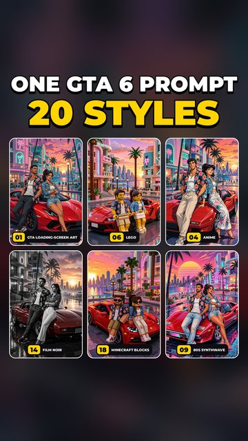
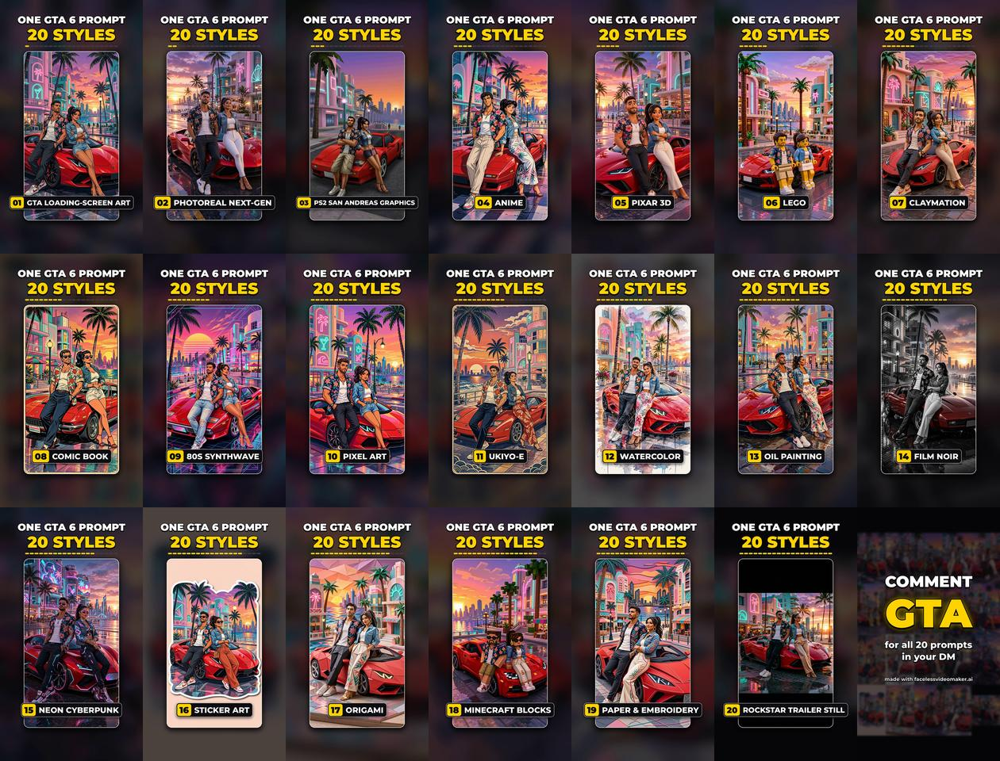

# 16 · 1 GTA 6 Prompt, 20 Styles



A 24-second reel of **one Vice City-style beachfront scene redrawn in 20 completely different art styles**. Same characters, same red sports car, same sunset street — only the style changes.

Built for [@faceless.recipes](https://www.instagram.com/faceless.recipes/). Comment **GTA** on the reel and we'll DM you this guide.

**Make it in [facelessvideomaker.ai](https://facelessvideomaker.ai).** Paste any prompt below, set the image to 9:16, and generate the stills in the app.

> These are AI-generated images. They're our own rebuild of a popular "one prompt, many styles" reel format, not any official game studio's art or process. Some style names describe a look (loading-screen art, clay, pixel, trailer still). No views or income are guaranteed. Always label AI content.



## Costs at a glance
These are the real costs of this reel, at Nov 2026 OpenRouter list prices. Prices change, so check each tool's pricing page.

| Item | Qty | Cost |
|---|---|---|
| MAI Image 2.7 Flash stills, 9:16 (20 used, plus 6 rerolls) | 26 | ~$0.27 |
| Voiceover (short style-name lines) | 1 | ~$0.004 |
| **Total** | | **~$0.28** |

- One finished still in a single style costs about **$0.011**.
- You can skip video entirely and cut the stills together in your editor.

---

## What you need
- An image model that takes a long text prompt at **9:16**. We used **MAI Image 2.7 Flash** (`microsoft/mai-image-2.7-flash`) through OpenRouter. Outputs came back at 768×1360.
- Or just generate the stills in **[facelessvideomaker.ai](https://facelessvideomaker.ai)**.
- Any editor (CapCut is fine) to cut the stills into a reel, plus an optional voice that reads each style name.
- We used an original synthesized beat, so there were no music-licence issues.

---

## How it works
1. Write **one base scene** in detail: two characters, the car, the street, the light, the framing, and the "no text" rules.
2. For each look, keep that scene and **swap only the style ending** (`rendered as…` / `rendered in the style of…`).
3. Generate every still at **9:16**. If a style comes back too close to photoreal, or the faces fall apart, rewrite it as a style-first prompt that says what everything is *made of*, and run it once more. We did that for origami.
4. Cut the 20 stills into a fast reel (about 1 second each), then a contact-sheet end card with a comment CTA.

You do not need a reference image for this set. The long shared scene description is what keeps the composition consistent.

---

## The base scene
Keep this block the same every time, then add one style ending from the list below.

```
A rugged man in his late 30s with short dark hair and stubble, wearing an open floral short-sleeve shirt over a white tank top, and a Latina woman in her late 20s with long dark hair in a high ponytail, gold hoop earrings and a cropped denim jacket, leaning side by side against the hood of a sleek red sports car on a palm-lined Miami-style beachfront street at sunset, pink and teal neon signs glowing on art deco buildings, orange and purple sky, confident cool poses, full bodies and the car in frame, vertical portrait composition, no text, no logos, no license plate text,
```

### Style endings (swap these)

- **01. GTA loading-screen art:** `rendered in the style of a classic open-world crime game loading-screen illustration: bold clean ink outlines, flat cel-shaded colors, hand-painted poster art look, slightly exaggerated heroic poses.`
- **02. Photoreal next-gen:** `rendered as a photorealistic next-gen video game screenshot: ray-traced reflections on the car paint, wet asphalt, volumetric sunset light, ultra-detailed skin and fabric, cinematic depth of field.`
- **03. PS2 San Andreas graphics:** `rendered as a 2004 PlayStation 2 era video game screenshot: low-polygon blocky character models, blurry low-resolution textures, flat lighting, heavy draw-distance fog, retro early-3D game look.`
- **04. Anime:** `rendered as a 90s anime key frame: clean cel animation line art, hand-painted background, dramatic sunset gradients, expressive anime faces.`
- **05. Pixar 3D:** `rendered as a 3D animated family movie still: stylized characters with big expressive eyes and soft rounded features, smooth subsurface skin, warm studio-quality lighting.`
- **06. LEGO:** `rendered built entirely from plastic toy building bricks: both characters as brick minifigures with yellow cylindrical heads and claw hands, brick-built car, palm trees and buildings, toy photography with shallow depth of field.`
- **07. Claymation:** `rendered as a stop-motion claymation scene: handmade plasticine characters with visible fingerprints and tool marks, clay car and miniature set, soft studio lighting.`
- **08. Comic book:** `rendered as a vintage American comic book panel: heavy black ink outlines, halftone dot shading, bold primary colors, dynamic crosshatching, no speech bubbles, no lettering.`
- **09. 80s Synthwave:** `rendered as 80s synthwave retro art: glowing neon magenta and cyan outlines, giant striped setting sun, wireframe grid road, chrome highlights, VHS glow.`
- **10. Pixel art:** `rendered as 16-bit pixel art: crisp visible square pixels, limited retro color palette, dithered sunset sky, classic arcade game look.`
- **11. Ukiyo-e:** `rendered as a traditional Japanese ukiyo-e woodblock print: flat areas of color, fine carved outlines, stylized wave-like clouds, aged washi paper texture, muted indigo and vermilion palette.`
- **12. Watercolor:** `rendered as a loose watercolor painting: soft wet-on-wet washes, visible paper grain, bleeding pigments, delicate pencil underdrawing.`
- **13. Oil painting:** `rendered as a classical oil painting on canvas: rich impasto brushstrokes, visible canvas texture, dramatic chiaroscuro warm light, gallery masterpiece feel.`
- **14. Film noir:** `rendered as a black-and-white 1940s film noir still: high-contrast monochrome, deep shadows, venetian-blind light streaks, rain-slick street, smoky atmosphere, neon rendered in shades of grey.`
- **15. Neon cyberpunk:** `rendered as a neon cyberpunk night scene: holographic billboards without readable text, rain, glowing cybernetic accents on their clothes, futuristic car, magenta and electric blue lighting.`
- **16. Sticker art:** `rendered as a die-cut vinyl sticker illustration: thick white sticker border around the whole group, bold flat vector colors, glossy highlight, isolated on a plain pastel background.`
- **17. Origami** — this one needed a full style-first rewrite (see prompt 17 below), because the short ending left too much photoreal skin.
- **18. Minecraft blocks:** `rendered as a blocky voxel sandbox game world: characters and car made of cubes, square pixelated block textures, cube palm trees, blocky sunset clouds.`
- **19. Paper & embroidery:** `rendered as a layered paper-cut diorama with embroidered thread details: stacked cut-paper layers casting soft shadows, characters' clothes and neon signs stitched in colorful embroidery thread, handcrafted texture.`
- **20. Rockstar trailer still:** `rendered as a cinematic movie trailer still: anamorphic widescreen framing with black letterbox bars top and bottom, teal-and-orange color grade, lens flare, film grain, shallow depth of field.`

---

## The 20 style prompts

Each prompt below is ready to paste as-is. They are numbered in reel order.

### 01 · GTA loading-screen art

```
A rugged man in his late 30s with short dark hair and stubble, wearing an open floral short-sleeve shirt over a white tank top, and a Latina woman in her late 20s with long dark hair in a high ponytail, gold hoop earrings and a cropped denim jacket, leaning side by side against the hood of a sleek red sports car on a palm-lined Miami-style beachfront street at sunset, pink and teal neon signs glowing on art deco buildings, orange and purple sky, confident cool poses, full bodies and the car in frame, vertical portrait composition, no text, no logos, no license plate text, rendered in the style of a classic open-world crime game loading-screen illustration: bold clean ink outlines, flat cel-shaded colors, hand-painted poster art look, slightly exaggerated heroic poses.
```

### 02 · Photoreal next-gen

```
A rugged man in his late 30s with short dark hair and stubble, wearing an open floral short-sleeve shirt over a white tank top, and a Latina woman in her late 20s with long dark hair in a high ponytail, gold hoop earrings and a cropped denim jacket, leaning side by side against the hood of a sleek red sports car on a palm-lined Miami-style beachfront street at sunset, pink and teal neon signs glowing on art deco buildings, orange and purple sky, confident cool poses, full bodies and the car in frame, vertical portrait composition, no text, no logos, no license plate text, rendered as a photorealistic next-gen video game screenshot: ray-traced reflections on the car paint, wet asphalt, volumetric sunset light, ultra-detailed skin and fabric, cinematic depth of field.
```

### 03 · PS2 San Andreas graphics

```
A rugged man in his late 30s with short dark hair and stubble, wearing an open floral short-sleeve shirt over a white tank top, and a Latina woman in her late 20s with long dark hair in a high ponytail, gold hoop earrings and a cropped denim jacket, leaning side by side against the hood of a sleek red sports car on a palm-lined Miami-style beachfront street at sunset, pink and teal neon signs glowing on art deco buildings, orange and purple sky, confident cool poses, full bodies and the car in frame, vertical portrait composition, no text, no logos, no license plate text, rendered as a 2004 PlayStation 2 era video game screenshot: low-polygon blocky character models, blurry low-resolution textures, flat lighting, heavy draw-distance fog, retro early-3D game look.
```

### 04 · Anime

```
A rugged man in his late 30s with short dark hair and stubble, wearing an open floral short-sleeve shirt over a white tank top, and a Latina woman in her late 20s with long dark hair in a high ponytail, gold hoop earrings and a cropped denim jacket, leaning side by side against the hood of a sleek red sports car on a palm-lined Miami-style beachfront street at sunset, pink and teal neon signs glowing on art deco buildings, orange and purple sky, confident cool poses, full bodies and the car in frame, vertical portrait composition, no text, no logos, no license plate text, rendered as a 90s anime key frame: clean cel animation line art, hand-painted background, dramatic sunset gradients, expressive anime faces.
```

### 05 · Pixar 3D

```
A rugged man in his late 30s with short dark hair and stubble, wearing an open floral short-sleeve shirt over a white tank top, and a Latina woman in her late 20s with long dark hair in a high ponytail, gold hoop earrings and a cropped denim jacket, leaning side by side against the hood of a sleek red sports car on a palm-lined Miami-style beachfront street at sunset, pink and teal neon signs glowing on art deco buildings, orange and purple sky, confident cool poses, full bodies and the car in frame, vertical portrait composition, no text, no logos, no license plate text, rendered as a 3D animated family movie still: stylized characters with big expressive eyes and soft rounded features, smooth subsurface skin, warm studio-quality lighting.
```

### 06 · LEGO

```
A rugged man in his late 30s with short dark hair and stubble, wearing an open floral short-sleeve shirt over a white tank top, and a Latina woman in her late 20s with long dark hair in a high ponytail, gold hoop earrings and a cropped denim jacket, leaning side by side against the hood of a sleek red sports car on a palm-lined Miami-style beachfront street at sunset, pink and teal neon signs glowing on art deco buildings, orange and purple sky, confident cool poses, full bodies and the car in frame, vertical portrait composition, no text, no logos, no license plate text, rendered built entirely from plastic toy building bricks: both characters as brick minifigures with yellow cylindrical heads and claw hands, brick-built car, palm trees and buildings, toy photography with shallow depth of field.
```

### 07 · Claymation

```
A rugged man in his late 30s with short dark hair and stubble, wearing an open floral short-sleeve shirt over a white tank top, and a Latina woman in her late 20s with long dark hair in a high ponytail, gold hoop earrings and a cropped denim jacket, leaning side by side against the hood of a sleek red sports car on a palm-lined Miami-style beachfront street at sunset, pink and teal neon signs glowing on art deco buildings, orange and purple sky, confident cool poses, full bodies and the car in frame, vertical portrait composition, no text, no logos, no license plate text, rendered as a stop-motion claymation scene: handmade plasticine characters with visible fingerprints and tool marks, clay car and miniature set, soft studio lighting.
```

### 08 · Comic book

```
A rugged man in his late 30s with short dark hair and stubble, wearing an open floral short-sleeve shirt over a white tank top, and a Latina woman in her late 20s with long dark hair in a high ponytail, gold hoop earrings and a cropped denim jacket, leaning side by side against the hood of a sleek red sports car on a palm-lined Miami-style beachfront street at sunset, pink and teal neon signs glowing on art deco buildings, orange and purple sky, confident cool poses, full bodies and the car in frame, vertical portrait composition, no text, no logos, no license plate text, rendered as a vintage American comic book panel: heavy black ink outlines, halftone dot shading, bold primary colors, dynamic crosshatching, no speech bubbles, no lettering.
```

### 09 · 80s Synthwave

```
A rugged man in his late 30s with short dark hair and stubble, wearing an open floral short-sleeve shirt over a white tank top, and a Latina woman in her late 20s with long dark hair in a high ponytail, gold hoop earrings and a cropped denim jacket, leaning side by side against the hood of a sleek red sports car on a palm-lined Miami-style beachfront street at sunset, pink and teal neon signs glowing on art deco buildings, orange and purple sky, confident cool poses, full bodies and the car in frame, vertical portrait composition, no text, no logos, no license plate text, rendered as 80s synthwave retro art: glowing neon magenta and cyan outlines, giant striped setting sun, wireframe grid road, chrome highlights, VHS glow.
```

### 10 · Pixel art

```
A rugged man in his late 30s with short dark hair and stubble, wearing an open floral short-sleeve shirt over a white tank top, and a Latina woman in her late 20s with long dark hair in a high ponytail, gold hoop earrings and a cropped denim jacket, leaning side by side against the hood of a sleek red sports car on a palm-lined Miami-style beachfront street at sunset, pink and teal neon signs glowing on art deco buildings, orange and purple sky, confident cool poses, full bodies and the car in frame, vertical portrait composition, no text, no logos, no license plate text, rendered as 16-bit pixel art: crisp visible square pixels, limited retro color palette, dithered sunset sky, classic arcade game look.
```

### 11 · Ukiyo-e

```
A rugged man in his late 30s with short dark hair and stubble, wearing an open floral short-sleeve shirt over a white tank top, and a Latina woman in her late 20s with long dark hair in a high ponytail, gold hoop earrings and a cropped denim jacket, leaning side by side against the hood of a sleek red sports car on a palm-lined Miami-style beachfront street at sunset, pink and teal neon signs glowing on art deco buildings, orange and purple sky, confident cool poses, full bodies and the car in frame, vertical portrait composition, no text, no logos, no license plate text, rendered as a traditional Japanese ukiyo-e woodblock print: flat areas of color, fine carved outlines, stylized wave-like clouds, aged washi paper texture, muted indigo and vermilion palette.
```

### 12 · Watercolor

```
A rugged man in his late 30s with short dark hair and stubble, wearing an open floral short-sleeve shirt over a white tank top, and a Latina woman in her late 20s with long dark hair in a high ponytail, gold hoop earrings and a cropped denim jacket, leaning side by side against the hood of a sleek red sports car on a palm-lined Miami-style beachfront street at sunset, pink and teal neon signs glowing on art deco buildings, orange and purple sky, confident cool poses, full bodies and the car in frame, vertical portrait composition, no text, no logos, no license plate text, rendered as a loose watercolor painting: soft wet-on-wet washes, visible paper grain, bleeding pigments, delicate pencil underdrawing.
```

### 13 · Oil painting

```
A rugged man in his late 30s with short dark hair and stubble, wearing an open floral short-sleeve shirt over a white tank top, and a Latina woman in her late 20s with long dark hair in a high ponytail, gold hoop earrings and a cropped denim jacket, leaning side by side against the hood of a sleek red sports car on a palm-lined Miami-style beachfront street at sunset, pink and teal neon signs glowing on art deco buildings, orange and purple sky, confident cool poses, full bodies and the car in frame, vertical portrait composition, no text, no logos, no license plate text, rendered as a classical oil painting on canvas: rich impasto brushstrokes, visible canvas texture, dramatic chiaroscuro warm light, gallery masterpiece feel.
```

### 14 · Film noir

```
A rugged man in his late 30s with short dark hair and stubble, wearing an open floral short-sleeve shirt over a white tank top, and a Latina woman in her late 20s with long dark hair in a high ponytail, gold hoop earrings and a cropped denim jacket, leaning side by side against the hood of a sleek red sports car on a palm-lined Miami-style beachfront street at sunset, pink and teal neon signs glowing on art deco buildings, orange and purple sky, confident cool poses, full bodies and the car in frame, vertical portrait composition, no text, no logos, no license plate text, rendered as a black-and-white 1940s film noir still: high-contrast monochrome, deep shadows, venetian-blind light streaks, rain-slick street, smoky atmosphere, neon rendered in shades of grey.
```

### 15 · Neon cyberpunk

```
A rugged man in his late 30s with short dark hair and stubble, wearing an open floral short-sleeve shirt over a white tank top, and a Latina woman in her late 20s with long dark hair in a high ponytail, gold hoop earrings and a cropped denim jacket, leaning side by side against the hood of a sleek red sports car on a palm-lined Miami-style beachfront street at sunset, pink and teal neon signs glowing on art deco buildings, orange and purple sky, confident cool poses, full bodies and the car in frame, vertical portrait composition, no text, no logos, no license plate text, rendered as a neon cyberpunk night scene: holographic billboards without readable text, rain, glowing cybernetic accents on their clothes, futuristic car, magenta and electric blue lighting.
```

### 16 · Sticker art

```
A rugged man in his late 30s with short dark hair and stubble, wearing an open floral short-sleeve shirt over a white tank top, and a Latina woman in her late 20s with long dark hair in a high ponytail, gold hoop earrings and a cropped denim jacket, leaning side by side against the hood of a sleek red sports car on a palm-lined Miami-style beachfront street at sunset, pink and teal neon signs glowing on art deco buildings, orange and purple sky, confident cool poses, full bodies and the car in frame, vertical portrait composition, no text, no logos, no license plate text, rendered as a die-cut vinyl sticker illustration: thick white sticker border around the whole group, bold flat vector colors, glossy highlight, isolated on a plain pastel background.
```

### 17 · Origami

This is a full style-first rewrite, not the base scene plus a short ending.

```
A tabletop diorama where everything is folded from origami paper. A rugged man in his late 30s with short dark hair and stubble, wearing an open floral short-sleeve shirt over a white tank top, and a Latina woman in her late 20s with long dark hair in a high ponytail, gold hoop earrings and a cropped denim jacket, leaning side by side against the hood of a sleek red sports car on a palm-lined Miami-style beachfront street at sunset, pink and teal neon signs glowing on art deco buildings, orange and purple sky, confident cool poses, full bodies and the car in frame, vertical portrait composition, no text, no logos, no license plate text, rendered with the man, the woman, their faces and clothes, the car, palm trees and buildings all made of crisp folded colored craft paper with sharp creases and geometric faceted paper planes, no real skin, soft studio lighting, macro photography of a paper model.
```

### 18 · Minecraft blocks

```
A rugged man in his late 30s with short dark hair and stubble, wearing an open floral short-sleeve shirt over a white tank top, and a Latina woman in her late 20s with long dark hair in a high ponytail, gold hoop earrings and a cropped denim jacket, leaning side by side against the hood of a sleek red sports car on a palm-lined Miami-style beachfront street at sunset, pink and teal neon signs glowing on art deco buildings, orange and purple sky, confident cool poses, full bodies and the car in frame, vertical portrait composition, no text, no logos, no license plate text, rendered as a blocky voxel sandbox game world: characters and car made of cubes, square pixelated block textures, cube palm trees, blocky sunset clouds.
```

### 19 · Paper & embroidery

```
A rugged man in his late 30s with short dark hair and stubble, wearing an open floral short-sleeve shirt over a white tank top, and a Latina woman in her late 20s with long dark hair in a high ponytail, gold hoop earrings and a cropped denim jacket, leaning side by side against the hood of a sleek red sports car on a palm-lined Miami-style beachfront street at sunset, pink and teal neon signs glowing on art deco buildings, orange and purple sky, confident cool poses, full bodies and the car in frame, vertical portrait composition, no text, no logos, no license plate text, rendered as a layered paper-cut diorama with embroidered thread details: stacked cut-paper layers casting soft shadows, characters' clothes and neon signs stitched in colorful embroidery thread, handcrafted texture.
```

### 20 · Rockstar trailer still

```
A rugged man in his late 30s with short dark hair and stubble, wearing an open floral short-sleeve shirt over a white tank top, and a Latina woman in her late 20s with long dark hair in a high ponytail, gold hoop earrings and a cropped denim jacket, leaning side by side against the hood of a sleek red sports car on a palm-lined Miami-style beachfront street at sunset, pink and teal neon signs glowing on art deco buildings, orange and purple sky, confident cool poses, full bodies and the car in frame, vertical portrait composition, no text, no logos, no license plate text, rendered as a cinematic movie trailer still: anamorphic widescreen framing with black letterbox bars top and bottom, teal-and-orange color grade, lens flare, film grain, shallow depth of field.
```

---

## Make it your own
To invent a 21st style, paste the base scene and replace the ending with your medium. Be specific about materials, lighting and era, for example: "rendered as a 1970s Polaroid photograph: faded dyes, soft flash, light leaks."

To change the scene, rewrite the two characters, the car and the street, but keep the same rules: full bodies and the car in frame, vertical portrait, no text, no logos, no license-plate text, then attach any of the 20 style endings.

---

## Rebuild the reel layout (24 s, 1080×1920, 30 fps)
- Fast cuts of the 20 stills, one style per beat, with the style name on screen.
- Keep typography out of Instagram's top 250 px, below y ≈ 1540, and away from the right-hand button column.
- End on a contact sheet of all 20, plus "Comment GTA and I'll DM you all 20 prompts".
- Normalise audio to about −14 LUFS.
- Turn on the AI label before you post.

---

## Troubleshooting
- **Characters or the car change between styles:** keep the full base scene in every prompt; don't send the style line on its own.
- **A style looks like a filter on the photoreal version:** say what everything is made of (bricks, clay, paper, embroidery, plastic bricks) and reroll.
- **Text, logos or a licence plate appear:** keep "no text, no logos, no license plate text" at the end of the scene, and reroll once.
- **Faces collapse in a stylised medium** (origami, pixel, early-3D): lead with the medium, keep the pose, and accept a more graphic face if the silhouette still reads.
- Label your posts as AI-generated.

## Rules
- Copy the format, not someone else's footage. Never re-upload another creator's clips.
- Turn on the AI label (YouTube "altered or synthetic content", Instagram "AI info").

[← Back to all guides](../README.md)
