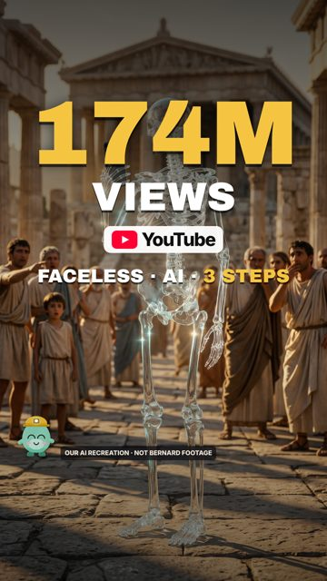
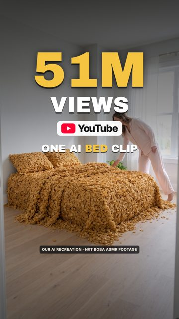
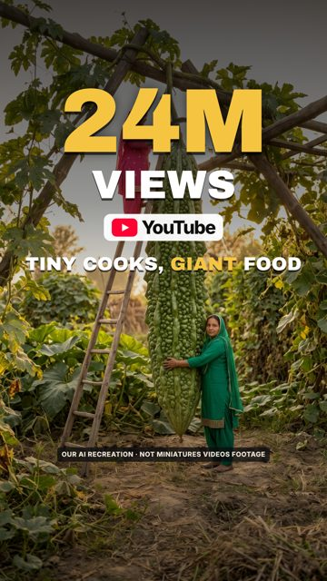
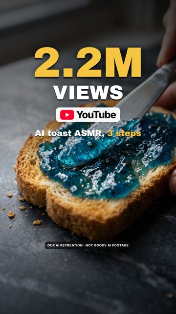
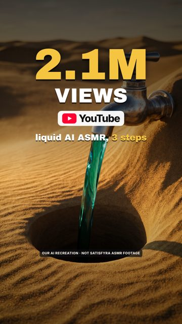
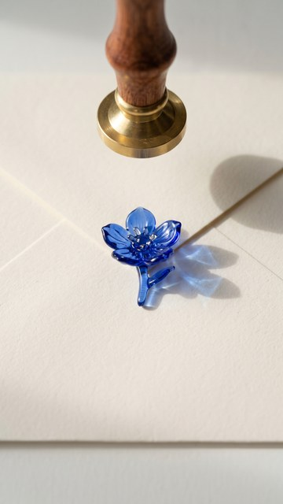

# Faceless AI Video Guides by @faceless.recipes

Free, copy-paste recipes for the faceless AI video formats broken down on Instagram [@faceless.recipes](https://www.instagram.com/faceless.recipes/).

**Find the reel you watched:** match the picture or the name below, then tap the guide. Each guide has the exact prompts, the tools and settings, what it cost, and fixes for common problems.

| # | Reel | What it looks like | Guide |
|---|---|---|---|
| 01 |  | **Glass skeleton "What if…" history Shorts** A see-through glass skeleton living through history/challenges, day by day | [Open guide 01](01-glass-skeleton-what-if-history/README.md) |
| 02 |  | **"Which bed would you sleep in?" surreal beds ASMR** Beds made of cornflakes, bubble wrap and wet sponges, with crunch/pop/squelch sounds | [Open guide 02](02-surreal-beds-asmr/README.md) |
| 03 |  | **Tiny cooks, giant food** Knee-high village cooks harvesting and cooking a bus-sized vegetable | [Open guide 03](03-tiny-cooks-giant-food/README.md) |
| 04 |  | **Pixar-style baby on a giant fruit** A cute 3D baby sitting on a giant strawberry/banana, taking a bite | [Open guide 04](04-fruit-baby-ai/README.md) |
| 05 |  | **AI toast ASMR** A butter knife spreading glossy surreal "blue raspberry crystals" on toast, with crunch sound | [Open guide 05](05-toast-asmr/README.md) |
| 06 |  | **Desert tap liquid ASMR** A chrome tap in the desert pouring teal liquid into a perfect hole in the sand | [Open guide 06](06-desert-tap-liquid-asmr/README.md) |
| 07 |  | **Glass flower seals** One glass flower pressed into a circular translucent seal on a plain envelope | [Open guide 07](07-glass-flower-seals/README.md) |

## Good to know
- These are **our rebuilds** of public formats, not the original creators' confirmed workflows.
- View counts are public YouTube numbers on the date in each guide. No views or income are guaranteed.
- Always label AI content and make your own characters, settings and sounds.

New guides are added with every reel, so bookmark this page.

## Adding a new reel (maintainers)
1. Create a folder `NN-short-descriptive-name/` with `README.md` (copy an existing guide's layout) and a small `cover.jpg` (360 px wide).
2. Add one row to the table above, keeping numbers in order.
3. Before publishing, check: no keys, emails, phone numbers, local paths or raw cost logs.
