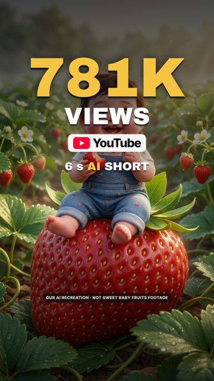
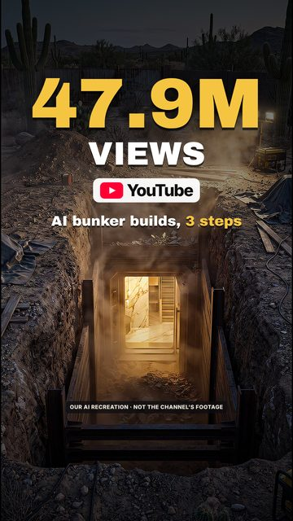
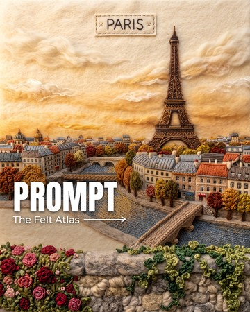
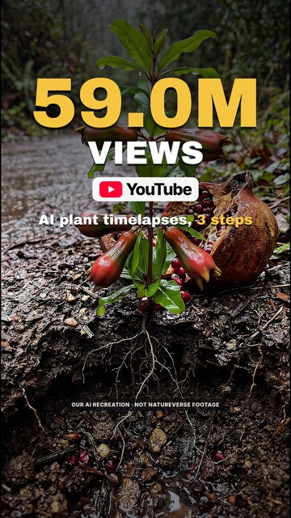
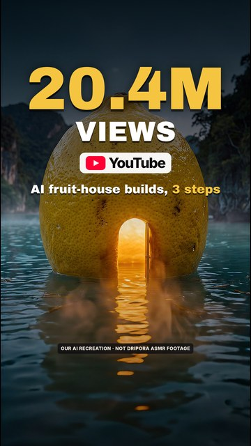
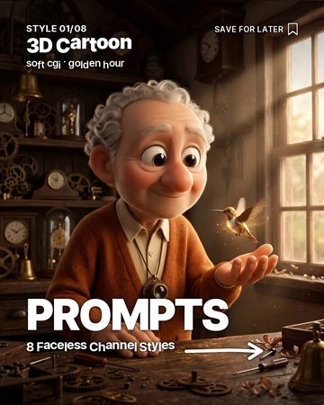

# Faceless AI Video Guides by @faceless.recipes

Free, copy-paste recipes for the faceless AI video formats broken down on Instagram [@faceless.recipes](https://www.instagram.com/faceless.recipes/).

**Find the reel you watched:** match the picture or the name below, then tap the guide. Each guide has the exact prompts, the tools and settings, what it cost, and fixes for common problems.

| # | Reel | What it looks like | Guide |
|---|---|---|---|
| 01 |  | **Glass skeleton "What if…" history Shorts** A see-through glass skeleton living through history/challenges, day by day | [Open guide 01](01-glass-skeleton-what-if-history/README.md) |
| 02 |  | **"Which bed would you sleep in?" surreal beds ASMR** Beds made of cornflakes, bubble wrap and wet sponges, with crunch/pop/squelch sounds | [Open guide 02](02-surreal-beds-asmr/README.md) |
| 03 |  | **Tiny cooks, giant food** Knee-high village cooks harvesting and cooking a bus-sized vegetable | [Open guide 03](03-tiny-cooks-giant-food/README.md) |
| 04 |  | **Pixar-style baby on a giant fruit** A cute 3D baby sitting on a giant strawberry/banana, taking a bite | [Open guide 04](04-fruit-baby-ai/README.md) |
| 05 |  | **AI toast ASMR** A butter knife spreading glossy surreal "blue raspberry crystals" on toast, with crunch sound | [Open guide 05](05-toast-asmr/README.md) |
| 06 |  | **Desert tap liquid ASMR** A chrome tap in the desert pouring teal liquid into a perfect hole in the sand | [Open guide 06](06-desert-tap-liquid-asmr/README.md) |
| 07 |  | **Glass flower seals** One glass flower pressed into a circular translucent seal on a plain envelope | [Open guide 07](07-glass-flower-seals/README.md) |
| 08 |  | **Paint-tube sea creatures ASMR** A blank paint tube squeezing translucent gel that becomes a sea creature | [Open guide 08](08-paint-tube-sea-creatures-asmr/README.md) |
| 09 |  | **Luxury desert bunker AI build** A locked-wide desert dig excavating into a glowing luxury underground bunker entrance | [Open guide 09](09-luxury-desert-bunker-ai-build/README.md) |
| 10 |  | **The Hidden Atlas** Handmade paper-cut posters of secret luxury bunkers around the world, with sewn location labels. Comment GUIDE for all 10 prompts | [Open guide 10](10-the-hidden-atlas/README.md) |
| 11 |  | **The Felt Atlas** World cities as handmade needle-felt and knitted-wool posters, with a felt location tag at the top. Comment GUIDE for all 20 prompts | [Open guide 11](11-the-felt-atlas/README.md) |
| 12 |  | **10 Faceless Channel Styles** One scene redrawn in 10 faceless YouTube styles (stick figure, whiteboard, 3D cartoon, dark doc, anime, clay, paper, pixel, infographic, cinematic). Comment GUIDE for all 10 prompts | [Open guide 12](12-faceless-channel-styles/README.md) |
| 13 |  | **Fallen plant life-cycle AI timelapse** A seed or fruit falls on soil, a sprout rises, and a new plant forms in a locked-camera 6-second timelapse | [Open guide 13](13-fallen-plant-lifecycle-ai/README.md) |
| 14 |  | **Giant fruit-house AI builds** A giant fruit lands in water, a doorway is cut in the skin, and a cozy interior glows inside | [Open guide 14](14-giant-fruit-house-ai/README.md) |
| 15 |  | **8 Faceless Channel Styles** Eight distinct scenes in eight faceless YouTube styles (3D cartoon, claymation, lo-fi anime, dark doc, paper, pixel, infographic, cinematic), as an animated carousel. Comment GUIDE for all 8 prompts | [Open guide 15](15-8-faceless-channel-styles/README.md) |

## Good to know
- These are **our rebuilds** of public formats, not the original creators' confirmed workflows.
- View counts are public YouTube numbers on the date in each guide. No views or income are guaranteed.
- Always label AI content and make your own characters, settings and sounds.

New guides are added with every reel, so bookmark this page.

## Adding a new reel (maintainers)
1. Create a folder `NN-short-descriptive-name/` with `README.md` (copy an existing guide's layout) and a small `cover.jpg` (360 px wide).
2. Add one row to the table above, keeping numbers in order.
3. Before publishing, check: no keys, emails, phone numbers, local paths or raw cost logs.
